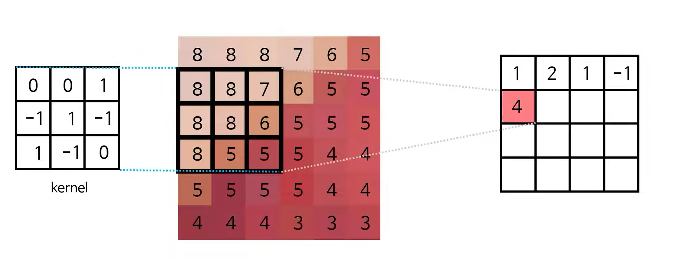
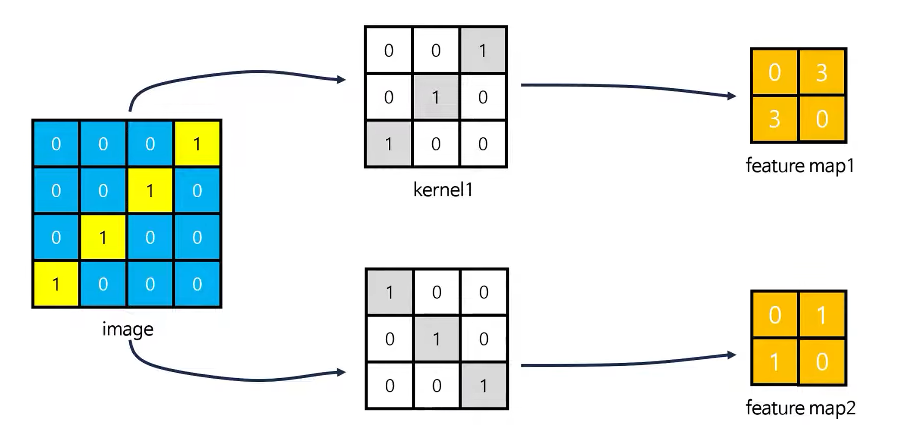

## CNN 이해

위 그림처럼 특정한 계산식을 기반으로 윈도우 안에서 계산을 통해 새로운 feature map을 만든다.
윈도우는 슬라이딩하며 옆으로 옮겨간다

$$
8 * 0 + 8 * 7 +  7 * 1 + 8 * (-1) + 8   * 1 + 8 * (-1) + 6 * (-1) + 8 * 1 + 5  * (-1) + 5 * 0 = 4
$$

이는 합성곱 연산의 핵심이다.

합성곱 연산은 중요하다

kernel (특정 계산식)이 image와 같을수록 출력 값이 높다. 반면에 밑에 kernel 블록은 실제 image와 비슷하지 않다. 이는 feature map2에 영향을 주어 출력값이 낮아지는 결과로 이어진다

합성곱층이 깊어지면 더 복잡한 이미지도 분류할 수 있다. 이는 한 feature map을 또 합성곱 연산을 돌리기 때문에, 더 정교한 분류가 가능하다

kernel의 크기가 다르면 두 개의 feature map이 달라진다

슬라이딩 윈도우와 같이 kernel이 움직인다. 한 방향으로 한 칸씩 이동할 것이다.
이런 이동량의 조정을 stride라고 한다

- stride 2 : 다음 윈도우 이동 시 2칸 움직임
- stride 1 : 다음 윈도우 이동 시 1칸 움직임

---

## 특정 모습에 대한 정확도

개발자는 자동차를 찾고 싶어 한다. 이는 정답 시 (1, 0)으로 출력이 나온다.
실제로 (0.7, 0)의 출력이 나올 때, 이를 향상시키고자 kernel의 모양을 자동차와 비슷하게 수정할 수 있다.
