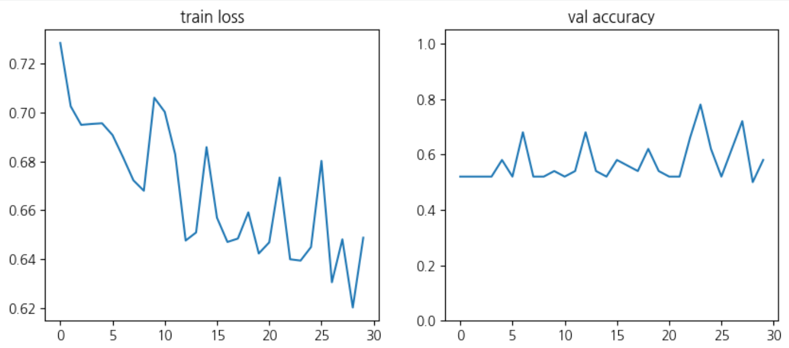
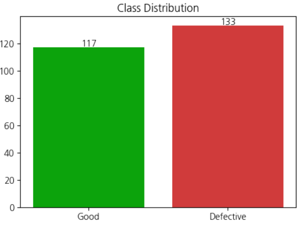
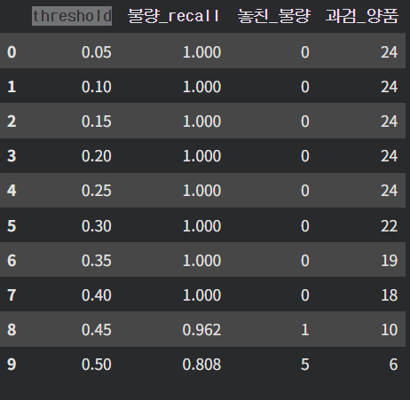
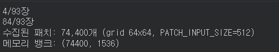
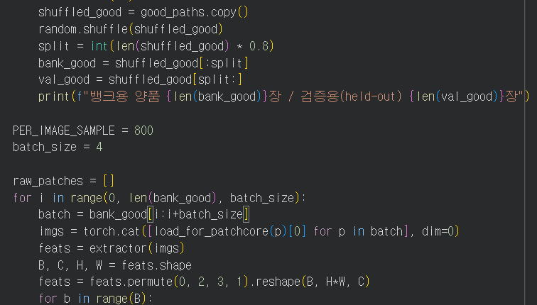
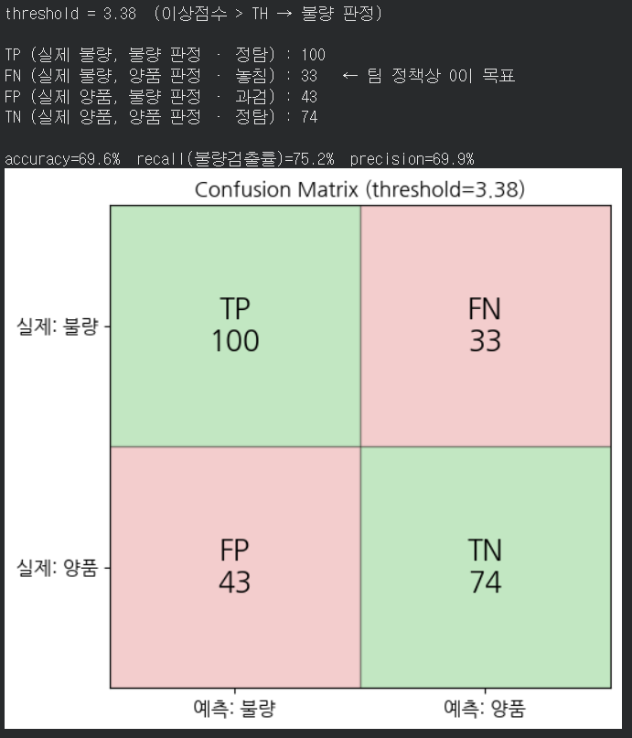
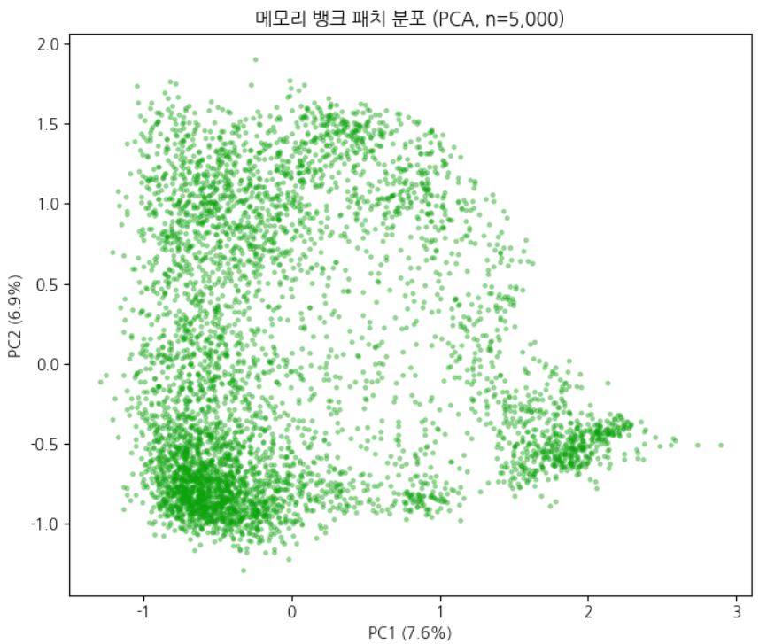
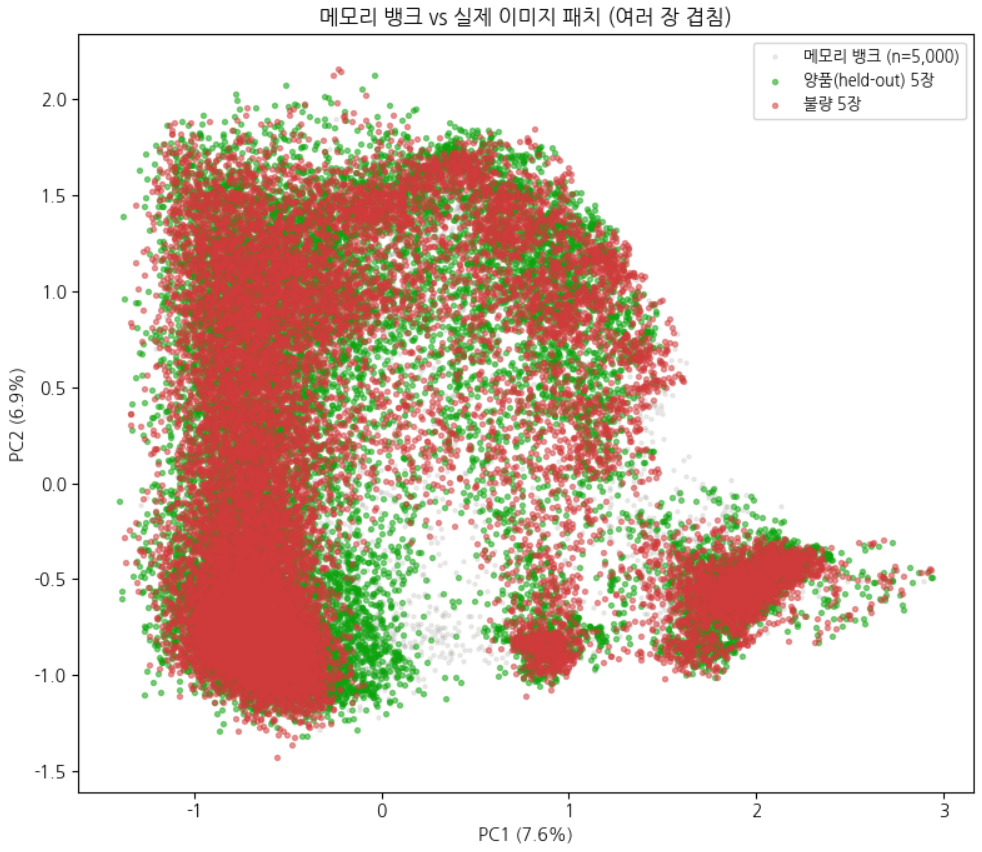
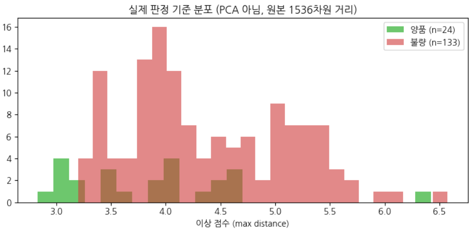
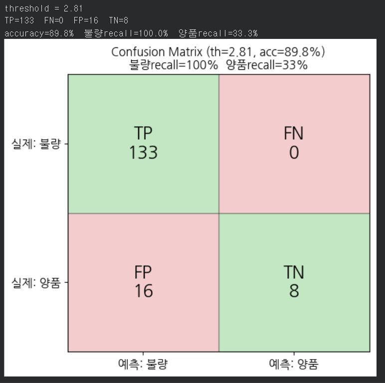

## Accuracy

첫 학습 후 검증에서 accuracy 76%가 나왔다. 목표치인 최소 84%에 한참 못 미치는 수치이다.

**다음 두 방법으로 Accuracy를 높이고자 한다**

- PATCH_INPUT_SIZE 조정
    - 원본 이미지 전체를 리사이즈한다
        ⇒ 더 세세한 탐지를 위해 전체 크기를 줄임
- Memory_bank
    - 격자 칸들의 특징 벡터를 양품 이미지들에서 전부 모아놓은 것
        그러므로 양품 패턴들만 모아놓은 자료이다.

        새 이미지에서 각 격자 칸 특징을 memory bank와 비교한다

⇒ 2%의 accuracy를 낮추었다

새로운 방법으로 행렬곱의 핵심인 커널을 조정해 보기로 했다.

```c
return F.avg_pool2d(combined, kernel_size=3, stride=1, padding=1)
```

현재는 각 격자 칸의 특징을 주변 3 \* 3 이웃과 평균 내서 부드럽게 판단하는 과정을 거치지만
이 kernel size를 더 줄여서 더욱 세세한 검증을 할 수 있게 할 예정이다

---

## 모델

일단 데이터 250개를 가지고 진행한 학습에서는 모델 구축과 여러 검사가 끝났으니 정리를 해보려 한다.

사용 정보 :

- 사용 모델 : CNN
- Layer : 3

<details>
<summary>Basic Arch</summary>

#### 개발 초기 모델 구성

250장 이미지 중

- 학습 : 200장
- 검증 : 50장
- 검증 세트 불량 비율 : 26/50

3개의 레이어로 3\*3 커널의 필터를 [16, 32, 64]개로 설정했다.
파라미터 수 : 98,178

Epoch : 30번 진행하였고, 78%의 최고 검증 정확도를 가진다.



실제 Train loss 그래프가 격변한다. 이는 데이터 품질이 CNN이 확인할 수 없는 크기의 먼지/스크래치를 불량으로 라벨링하여 생긴 문제로 판단된다.

val accuracy는 검증 정확도를 의미한다. 위에서 데이터를 4 : 1 비율로 나누었다.

- 4 : 학습용 ⇒ Train loss에서 사용
- 1 : 검증용 ⇒ Val accuracy에 사용



분류를 표로 그리면 다음과 같다 (117 + 133 = 250)

</details>

<details>
<summary>1.try</summary>

#### threshold 변화

간단하게 threshold에 변화를 주었다. 기본적으로 얼마를 기준으로 볼지 중요한지 표로 나타내었다



반도체 소자 검증에서는 threshold를 느슨하게 진행할 수 없으므로, 이에 대해 모델/학습의 과정에서 문제가 있었음을 알 수 있다.
(0.5를 기준으로 놓친 불량 5개)

</details>

<details>
<summary>2.try</summary>

#### Memory Bank

```c
이미지 -> CNN (Filter/Kernel) -> Feature Vector -> Memory Bank -> ....
```

- CNN의 Filter (kernel)은 학습되는 가중치 파라미터이다.
    ⇒ 한 Layer가 합성곱에서 Feature map을 만드는 데에 쓰이는 것
    ⇒ 특징을 추출하는 규칙이다
- Memory Bank
    ⇒ CNN이 추출한 Feature Vector들을 저장하는 것
    ⇒ 정상 특징의 저장



93장의 이미지에서 74,400개의 Feature (특징 벡터)를 추출해서 저장한 것
이 필터와 새로 들어온 이미지를 대조하여 결과물에 반영한다.



- 한 이미지에서 800개의 특징을 추출한다
    - 800은 PatchCore의 성능 ↔ 속도 ↔ 메모리를 trade off한다

    ⇒ img 한 장에서 feature는 64 \* 64 = 4096개 뽑을 수 있다
    4096 \* 93 = 380,000개를 뽑을 수 있다. 여기서 이를 모두 뽑아오면 연산이 엄청 필요하다 : (

</details>

<details>
<summary>3.try</summary>

#### 확인



엄,,, Accuracy가 69.6%를 찍어버렸따…



Kernel을 통해 학습한 CNN에서 정답만으로 추출한 Mem bank는 위와 같다.
총 세 개의 점 뭉텅이가 보인다. 이는 실제 이미지와 비교했을 때 더욱 확실하게 검증할 수 있다.



뭔가 문제가 있다. 두 점들이 쉽게 구분되지 않게 겹쳐있다.



이를 막대 그래프로 나타내었을 때 같은 점수대에서 불량과 양품이 동시에 존재하는 문제가 있다.

</details>

<details>
<summary>4.try</summary>

#### Memory Bank 문제 개선

기존 메모리 뱅크는 뭐가 문제였나?

- 표본이 너무 적어서 정상의 범위를 제대로 담지 못함
- PATCH_INPUT_SIZE + pool_kernel의 조합으로 정밀한 검사를 하지 못함
- 기존에는 Layer 1을 가지고 특징을 추출했는데, 이는 순수 엣지, 미세한 밝기 변화 등만 캐치하여 좋지 못함
    ⇒ Layer 2, Layer 3도 같이 사용

이렇게 적은 표본으로 추출된 Memory bank는 결과적으로 Accuracy 저하 문제를 일으킴

해결 방안

1. 메모리 뱅크에 데이터 증강 필터를 넣어 표본 늘리기
2. 업샘플 보간 방식을 bilinear에서 nearest로 바꾼 것
    ⇒ bilinear : 가장 가까운 4개로 보정
    ⇒ nearest : 가장 가까운 픽셀 값 복사
3. 지역 평균 (pool_kernel)을 3에서 1로 줄인 것
    ⇒ 자기 자신만 인자로 사용하여 주변 값의 영향을 안 받도록 수정



Confusion matrix로 표현하면 다음과 같다

</details>
