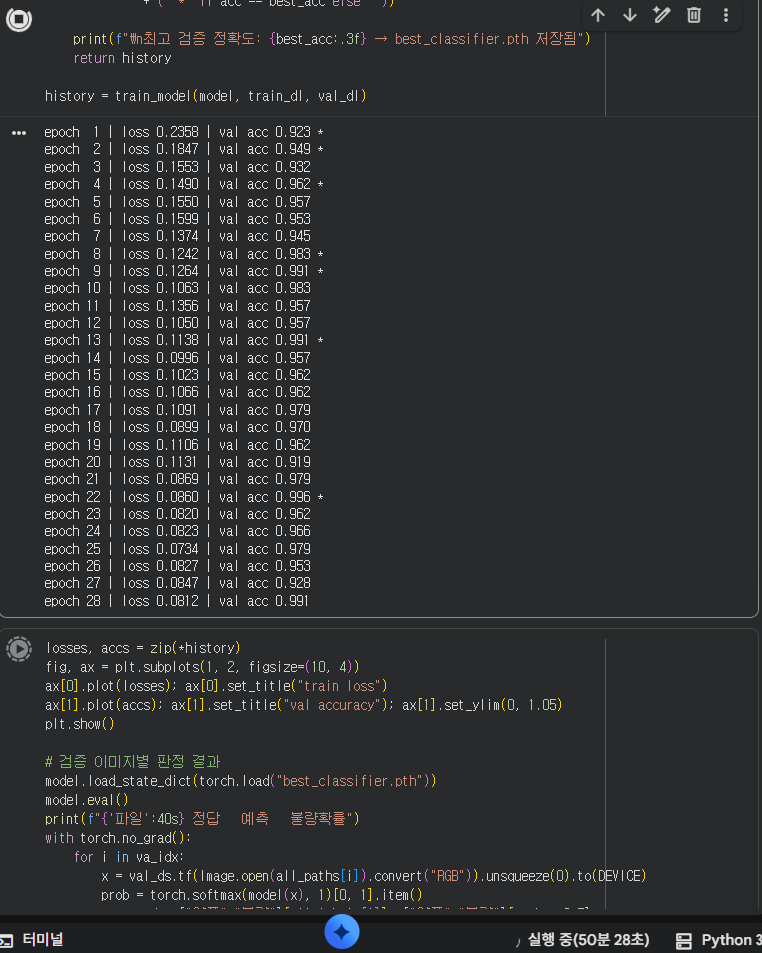
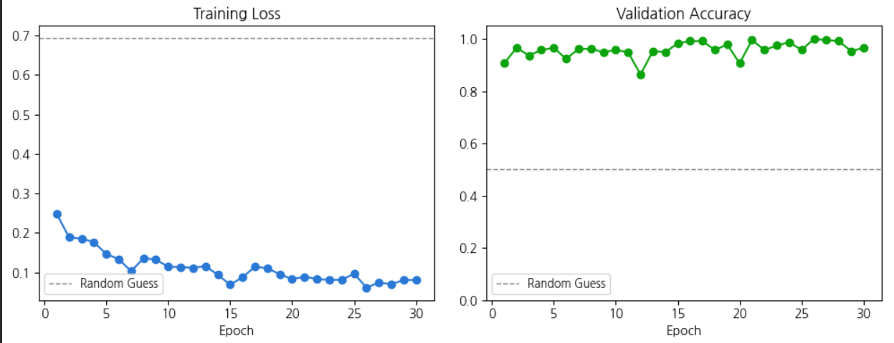
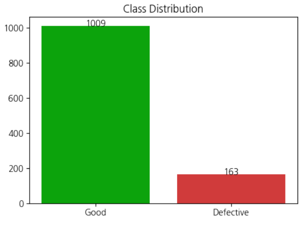

## 실상 (Over-fitting)

과적합이 발생한 거 같다.
데이터가 너무 적거나, 모델이 복잡하거나,,, 이번 경우는 편향된 데이터 때문인 것 같다

과적합은 train-set에 너무 과하게 모델이 최적화된 상태를 말한다. 모델이 과적합 상태이면, train-set에서는 정확도가 매우 높지만, test-set에서는 낮은 정확도가 나온다.
⇒ 범용성이 없는 학습 모델

현재는 train-set (학습용 데이터)에서는 89% accuracy를 찍었지만, test-set에서는 다시 69%로 돌아가는 문제가 생겼다.

과적합 증명

죽고싶다

돈이 없어서 CPU로 학습을 50분 동안 하는 내가 싫다..

과적합 해결

1. 데이터 추가 수집
    - 더 다양한 규칙 학습을 위한 데이터 준비한다.
2. feature 개수 줄이기
    - 관계성이 적거나 없는, 쓸모없는 입력 (feature)를 줄일 수 있다.
    - 쓸모없는 feature는 모델의 학습에 악영향을 주며 과적합의 요인이다.
3. Regularization (정규화)
    - 모델의 일반화 성능을 높여 과적합을 예방하는 방식이다.
    - 특정 파라미터의 가중치를 조절하는 방법이다.
4. Early Stopping
    - Train-loss와 Validation-loss가 함께 떨어지다가 Train-loss는 계속 감소하고 Validation-loss가 오르는 순간이 과적합이다.
    - 이 순간이 n번째 epoch라고 할 때 이 시점에서 학습을 멈추는 것이다.
5. Model Averaging
    - 여러 모델의 평균값으로 측정한다.
6. Dropout
    - 학습 시 랜덤한 뉴런 일부를 꺼버리는 방법이다.
    - 항상 같은 뉴런을 사용할 때 이 뉴런은 서로 의존성을 가진다. 이를 공동 적응이라고 한다.
    - 각 뉴런이 혼자서도 유용한 특징을 학습하도록, 특정 뉴런을 일부러 비활성화한다.

검증을 할 수 없다.
애초에 train-loss가 매우 낮은데 Accuracy는 이렇게 높은 상황이다. 이게 어떻게 과적합이 아니야?

무려 양불의 비율이 (6 : 1) 이다..
여기서 더 늘리는 Memory bank는 모델이 무거워지기만 하고, 과적합 상태에서 추출하는 특징은 의미가 없었다.
