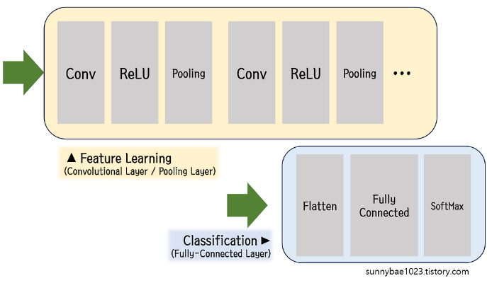
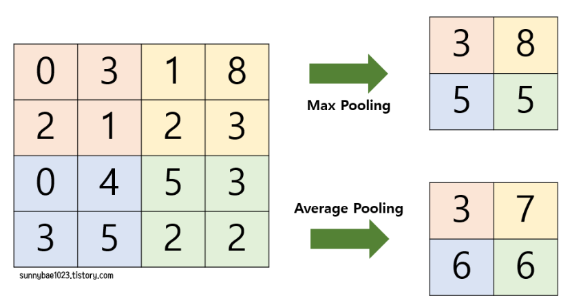
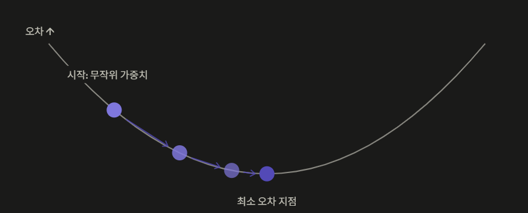

## 다시 설계

DNN은 2차원 이미지를 Flatten하는 과정에서 공간/지역적 정보를 잃는데, 이를 보완한 것이 CNN이다.
CNN은 기존 완전 연결 계층 (FC Layer)으로만 이뤄진 형태와 다르게 이미지를 raw data의 형태로 받음으로써 2차원 형태의 배열을 그대로 사용하여 기존의 형태를 변형하지 않고도 feature를 반영할 수 있다.

이미지를 추출하는 부분인 Conv Layer/Pooling Layer와 클래스를 분류하는 FC Layer로 나뉜다



1. Conv layer 단계는 입력 데이터와 필터 간의 합성곱 연산을 적용하여 feature가 강조된 이미지를 얻는다
    1. Input data + filter or kernel 합성곱 연산 진행
2. Padding은 5\*5 이미지에서 3\*3 kernel을 적용하면 feature map 역시 3\*3으로 줄어든다. 이때 가장자리 픽셀은 안쪽 픽셀보다 Convolution이 적게 반영된다.
    1. 가장자리에 정해진 픽셀만큼 특정 값을 채워 넣어 패딩을 형성한다. 이 값이 0일 때 Zero Padding이다
3. 각 픽셀의 데이터를 활성화 함수에 적용해 좀 더 판별력 있게 만든다. ReLU 이후에 윤곽선 등이 뚜렷해진다.
    1. ReLU는 활성화 함수로 입력값이 0보다 작으면 0을, 0보다 크면 입력값을 출력하는 함수이다.
4. Feature의 차원을 줄이는 단계가 연산량이 많은 FC Layer 전에 필요하다. 이를 Pooling Layer라고 한다. 이는 2차원 이상의 데이터의 공간적인 차원 축소를 위한 연산이다. Max Pooling과 Avg Pooling이 적용되어 feature map의 크기를 감소시킨다



1. Flatten 단계에서 데이터 정보를 1차원적으로 변환하는 과정이며 flatten된 벡터는 FC Layer의 인풋이 된다
2. FC Layer는 CNN의 최상단에 위치하며, 추출된 특징들을 바탕으로 최종적인 결말을 내린다. 모든 뉴런이 연결되어 있으며, Flatten된 입력 벡터는 각 노드에 가중치로 연결되며, 각 연결은 가중치를 곱하고 편향 (bias)을 더하는 연산을 수행한다.
3. FC Layer의 Output에 비선형 활성화 함수를 적용하는 단계이다. 이는 더 복잡한 모델을 학습시킬 수 있게 한다.

- 활성화 함수 : 층과 층 사이에 끼워 넣는 비선형 변환이다. Conv나 Linear는 전부 더하거나 곱하는 선형 연산이다. 이는 수학적으로 결국 하나의 연산으로 합쳐진다. 즉 conv 100층도 실질적으로 1층 모델과 표현력이 같다.
  이 층 사이에 비선형 계산을 넣어야 층을 쌓는 의미가 생긴다.
  ReLU ⇒ 중간층에서 표현력을 만든다
- FC Layer : 앞 층의 노드에 모두 연결된 층이다. Conv층에서 뽑은 특징 128개를 종합하여, "양품 점수, 불량 점수" 두 개로 압축하는 최종 판정을 맡는다.
  Flatten된 정보를 받아서 다음 식을 계산한다. 출력 = (각 특징 \* 가중치)의 합 + 편향으로 이뤄지며, 학습은 이 가중치를 조정하여 최고식을 찾는 것이다.

한 Conv층은 입력 채널 \* 출력 채널 \* 커널 \* 커널로 정해진다.
Conv2d(64, 128, 3)이면 64\*128\*3\*3 = 74,000개이다.

채널은 한 층이 뽑아내는 feature map의 개수이다.

- 구분할 패턴이 많으면 Output Channel이 많이 필요하다
- MaxPool로 해상도가 층마다 절반이 되므로, 위치 정보를 줄이고, 특징 종류를 늘린다
- 정확한 값이 정해진 것이 아니므로 직접 기계적 계산이 필요

---

## 개선

```javascript
model = build_cnn([16, 32, 64, 128]).to(DEVICE)
// 기존에 4개의 layer -> 98,178개의 파라미터

model = build_cnn([8, 16, 32]).to(DEVICE)
// layer를 3개로 줄임 -> 6,200개의 파라미터
```

- layer 1 : 8개 특징으로 구분
- layer 3 : 32개의 특징 구분

⇒ recall 실험 비교 필요

<details>
<summary>실험</summary>

| 구성 | 깊이 | 파라미터 | 불량 recall | precision | acc | 추론(ms) |
| --- | --- | --- | --- | --- | --- | --- |
| [8, 16], k3 | 2 | 1,450 | ? | ? | ? | ? |
| [4, 8, 16], k3 | 3 | 1,638 | ? | ? | ? | ? |
| [8, 16, 32], k3 | 3 | 6,154 | ? | ? | ? | ? |
| [8, 16, 32], k5 | 3 | 16,778 | ? | ? | ? | ? |
| [16, 32, 64], k3 | 3 | 23,826 | ? | ? | ? | ? |
| [16, 32, 64, 128], k3 | 4 | 97,938 | ? | ? | ? | ? |

- 변인 통제 : 모델 사이즈만 조절
- 실험 반복 : 실험 2~3회를 통해 평균을 내라

</details>

Output channel = 특징에서 학습할 수 있는 특징의 개수 상한선 = 너비
깊이 = layer = conv 개수
너비 \* 깊이 ⇒ 파라미터 수 조절 ⇒ 가장 적합한 무게, Accuracy 찾기

학습 부분에서 다음 내용 추가 :

```javascript
- Accuracy 외의 여러 지표 추가
- sliding rebalancing을 통한 같은 데이터 수에서 학습
- early stopping point 추가
- weight decay를 위한 Adam 대신 AdamW 사용
```

옵티마이저는 오차 (loss)를 보고 가중치를 어느 방향으로 얼마나 수정할지 결정하는 알고리즘이다.
모델 예측 → loss 함수 점수 확인 → loss.backward가 각 가중치 기울기를 계산 → 옵티마이저가 기울기를 보고 가중치 갱신

화살표 한 번 = opt.step() 한 번 → 이동 거리 = 학습률 (lr)



- lr이 너무 크면 loss가 다시 오르고, 너무 작으면 정해진 epoch 내에서 학습 실패

```javascript
def train_model(model, train_ds, val_dl, device,
                epochs=30, lr=1e-3, batch_size=32,
                patience=7, save_path="best_classifier.pth"):
    opt = torch.optim.AdamW(model.parameters(), lr=lr, weight_decay=1e-4)
    crit = nn.CrossEntropyLoss()
    best = {"recall": -1, "precision": -1, "acc": -1, "epoch": -1}
    no_improve, history = 0, []
```

1e-3은 Adam 계열의 표준 시작값으로, loss가 안 떨어지면 1e-4로 낮추거나 3e-3으로 올려보는 조정을 한다 (LR은 고정값이고, weight decay를 정규화한다.)
옵티마이저는 Loss를 줄이는 방향으로 이동하는 가중치를 준다, AdamW는 Weight decay를 사용하여 이 가중치 계산식에 항을 추가하여 계산한다
Loss (오차)가 줄지 않음 → 학습 x → lr (learning rate)를 조정하여 최소 오차 지점을 다시 찾는다

- Loss가 요동 \| 커짐 ⇒ lr이 너무 커서 이동 폭이 큼 → LR 낮추기
- Loss가 천천히 하락 ⇒ lr이 너무 작아서 폭이 좁음 → LR 올리기

아담은 자체가 파라미터를 업데이트하기에 1e-3이라는 안정적인 값에서 시작한다.
옵티마이저 종류는 다음 세 개를 볼 수 있다.

- SGD
    - 가장 단순한 원형
    - 기울기 \* 학습률만큼 이동
    - 이동 폭이 모든 가중치에 똑같이 적용 → 학습률을 잘 맞춰야 하고 수렴이 느리다
- Adam
    - 기울기의 이동 평균과 크기의 이력을 기억해서 가중치마다 걸음 크기를 자동 조정
    - 파라미터 자가 업데이트
- AdamW
    - Adam 모델에서 과적합을 억제하는 기능이 추가됨
    - 이동 가중치를 조금씩 0쪽으로 이동 → 모델이 특정 특징에 과의존하지 않게 막음
        - sliding rebalance를 사용하기에 같은 100장의 불량 사진을 계속 학습하므로, 이에 대한 과적합 방지
