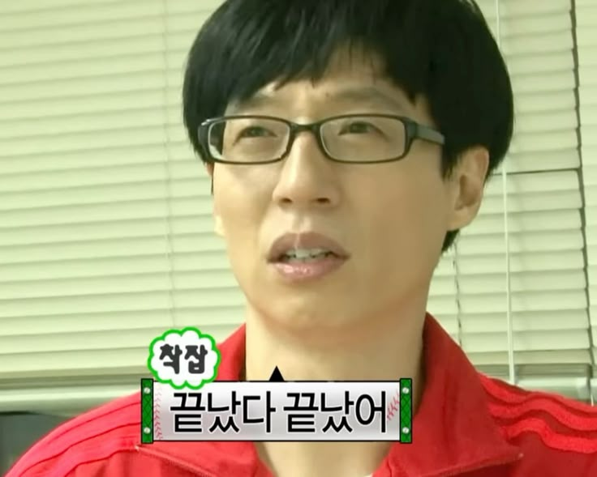
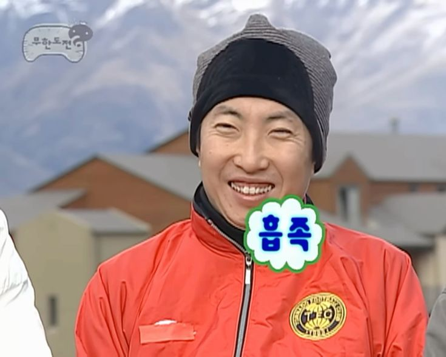
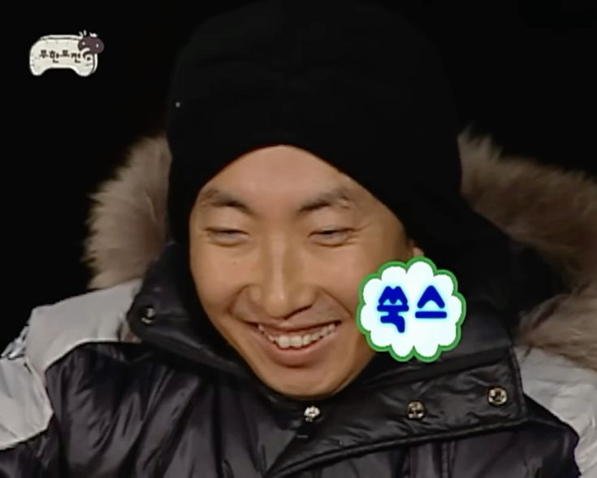

# 개인적 마무리 회고

프로젝트 Phosem의 마무리 회고를 진행하려 한다. 내 기분은 정확히 위 무도 짤과 같다… Phosem 프로젝트는 기업 Phosem이 의뢰한 PIN 다이오드 소자 불량 검출 AI를 개발하는 것이다.
무려 4개월을 진행한 프로젝트를 마무리 하려 하니 착잡한 심정과 해방감이 느껴지는 기분이다. 개발을 시작한 배경, 실제 개발 상황, 힘들었던 것, 해결 방법, 이후 마무리까지 소개해 보도록 하겠다.

---

먼저 개발 시작 배경이다. 당시에는 거의 4~5개의 대회를 동시에 나가고, ABC 프로젝트라는 국가가 진행하는 외부 활동까지 하고있는 시기였다. 그러던 중 갑자기 전호연 선생님께서 반도체 관련 AI를 만들 수 있는 기회를 가지는 프로젝트가 있는데, 해볼 사람이 있느냐고 인원 조사를 하셨다. 당시에 매우 바빴던 나는 시도는 커녕 생각도 들지 않았다. 여기서는 같은 과 친구 한 명과 같은 과 선배 하나가 지원했다.
그렇게 프로젝트가 지나가는줄 알았는데, 갑자기 권현진 선생님께서 찾아오셔서 프로젝트를 같이 하는 게 어떻냐고 제안하셨다. 당시에 여유로운 스케줄을 내기 힘든 나였지만 (내가 보기엔 엄살이긴 했다.) 선생님이 해보라고 권하셨기에 거절하지 않았고,, 그렇게 프로젝트를 시작하게 되는 것이 바로 프로젝트 시작 배경이다.

---

처음 이 프로젝트를 맡고 굉장히 쉬운 프로젝트라고 생각했다. 간단한 모양을 분류하는 AI를 제작하는 것이었기 때문이다. 하지막 막상 일을 진행해 보니 막 쉽게 진행되지 않았다. 첫 두 달을 기본 ML 개발을 공부하고, 각종 미팅을 가졌다. 여기서는 기본적인 배경지식을 학습하고, Resnet을 학습시키는 경험을 한 기간이었다. 이떄까지고 막연하게, 하다보면 되겠지,, 하는 생각이 있었던 거 같다. CNN 기초, 객체 인식, 학습 등을 배우며 앙상블, TTA, 지식 증류 등의 기법을 사용하여 개발을 진행했다.
단순하게 이미지를 가지고, 이를 만들어진 모델에 학습시켜 결과를 보는 방식이었고, 제대로 된 분석, 이해나 EDA조차 진행하지 않았기에 엉망진창 진행되었다.물돈 당시에는 이게 정석정 방식인줄 알고, 삽질을 하면서 꽤 힘들었다. 삽질인줄 알았더라면 다른 방법을 사용했을 것이다. 삽질이 삽질인줄 몰랐던 이유는, 내가 할줄 모르고, 아는 게 없었기 때문이다. 개발에 필요한 배경을 만들고, 공부했어도 결국 개발 방법도 모르고 개발하던 것이었다. 그렇게 삽질을 하며 문제가 있다는 것을 깨닫고 다시 공부를 해야겠다는 생각을 한다.
안드레 카파시가 블로그에 올린 ML 개발 방식에 관한 글이었다. 대충 EDA → EDA -> EDA → model 으로 대충 EDA가 겁나 중요하다는 것이었다. 그래서 나는 거의 한시간을 다이오드 사진만 쳐다보고, 분석했다.

이게 첫 두달의 개발 과정이고 남은 두달은 변화의 시작이었다. 먼저 데이터 4,000장 가량을 다시 학습하고, MIL 기법을 활용하여 CNN 객체 분류 모델을 개발했다. 결론적으로 AP 0.93을 도달하였다. 하지만 이는 우리가 직접 개발하며 라벨링을 맘대로 진행했던 문제가 있었고, 그렇기에 사용하기 부적합한 모델이었다. 이에 교수님은 현재 모델에 새 데이터로 학습을 시켜서 채점까지 해보자는 제안을 하셨고, 새로운 데이터로 학습을 진행했지만, 이전과 너무 달랐던 새 데이터는 Filter, ROI 등의 기법이 맞지 않았고 AP 0.64 언저리의 좋지 않은 성능을 보여주었다. 그후 6번째 모델을 개발을 시작했다.
이번 모델은 기존 CNN 분류 + Classification이 아닌 양/불을 판단하는 anomaly detection 모델이었다. 라벨과 사진 각각이 너무 상이했기에, 각기 다른 특징을 모아 판단하는 모델이 알맞다고 생각했다. 그렇기에 먼저 파이프라인을 구성했다. 가장 먼저 2,000장으로 Bank를 만드는 것이다. Bank는 양/불 판단 모델의 기본이 되는 모델이 정상을 판단할 수 있도록 하는 기준점이라 볼 수 있다. 이후 Outlier 방식을 활용하여 Bank 데이터 안에서 이상치를 보이는 데이터를 제외하는 작업을 진행하여, 이상 데이터를 찾고 EDA를 진행했다. 그리고 Novelty 방식을 위한 정상 Bank를 다시 뽑았다. 이 과정에서 다양한 지표를 만들고 평가하며 진행하였다. 이렇게 PatchCore 모델을 개발하였고, 이는 AP 0.803 정도의 성능을 보여주며, 다른 새 다이오드를 분류하는 데에 지장없이 동작했다. Bank 만들기 → Outlier → EDA → Novelty → PatchCore 파이프라인을 구성한 내가 만족스러웠다.

결론적으로 모델 보고서를 작성하여 교수님께 전달헀고, Phosem은 해당 모델을 사용하기로 결정했다. 이렇게 내 4개월의 개발은 마무리 되었다.

---

이제부터 힘들었던 것, 생각한 것, 마무리 회고를 적어보려 한다. 먼저 이 글은 내 감정을 더 남기기 위해서 개발 관련 표나 설명을 세세히 하지 않았다.
모델을 개발하며 내가 생각했던 것과 실제 환경이 다른 것을 많이 느꼈다. 회사가 요구하는 것, 제공하는 것은 내 예상과 많이 달라서 힘들었다. 가장 큰 주제는 데이터였다. 나는 우리가 데이터를 라벨링하고, 개발하는 것이 옳다고 생각했는데, 회사는 그렇지 않은 것이었다. 회사는 라벨링을 따로 진행하는 전문가가 있었고, 해당 전문가가 라벨링한 것과 우리가 한 라베링은 결국 데이터 품질이 떨어진다는 것이다. 그렇게 나온 모델은 결국 폐기되었던 사례가 있었기에 더욱 기억에 남는다.
또 팀원 역량에서 힘든 점이 있었다. 팀원 역량이라고 적으며 공격적인 스탠스를 취하겠다는 뜻은 아니다. 개발을 진행하며 2달 정도 지나고보니 아무도 개발을 안 하는 상황이 생겼다. 자세히 이야기 해보면 다음과 같다. 당시 최종 모델을 제출했어야 하는 일정이 있었고, 2명 중 나만 파일을 제출했다. (1명은 취업나가서 프젝 안 함) 나는 이 상황 자체에 의문을 가지고 담당 선생님께 여쭤보니, 한명이 개발을 너무 힘들어해서 개발을 일단 멈춰뒀고, 너 혼자 일단 진행하라는 말씀을 하셨다. 이 말을 듣고 솔직히 나는 개꿀이라고 생각했다. 그 친구가 역량 부족으로 개발을 못 하는 것은 안타까운 일이고, 나는 새 경험을 할 수 있으니 상관 없는 일이었다. (물론 그 친구가 개발을 못 하게 된 것이 잘 됐다는 이야기를 신나게 하는 것이 아니다.) 아무튼 그렇게 일이 진행되며, 나는 새 모델을 빠르게 만들었고 좋은 성적을 내며 프로젝트를 마쳤다.

| | |
| --- | --- |
|  |  |

담당 교수님께 파일을 제출하기 위해서 중간에서 담당 선생님이 이를 전다랳 주셨다. 그렇게 선생님과 주고받은 파일이 거진 40개나 되었다. 정말 많은 기술 보고서를 작성했고, 피드백을 받았다. 그리고 마지막 보고서를 제출하고,,, 교수님이 이를 발표하자고 하셨다. 나에게는 당연히 좋은 일이었기에 흔쾌히 수락하고, 발표 자료를 만들게 된다. 발표 자료를 제작하여 미리 선생님께 보내드렸는데, 발표 하루 전에 매우 많은 수정 사항을 전달해 주신 것이다. 해당 수정을 반영하기 위해서 7시간을 PPT만 만들고 중간고사 하루 전에 새벽 5시에 잠에 들고, 노트북을 뺐다가 걸려서 벌점도 받았다. 하지만 후회없이 71장의 PPT를 만들고 제출했다.
이후 해당 PPT로 발표를 진행했고, 굉장히 깨지기도 하고, 칭찬도 받았다. (정말 모자란 사람에게 많은 칭찬을 해주셨다.)
(ROC 그래프를 완전히 이해했고, 그렇기에 설명할 자신이 있었지만, 너무 떨리는 발표 현장에서 제대로 발표를 하지 못했다.. 이는 정말 아쉬운 상황이었다..)

발표는 정말 가관이었다. 너무 긴장을 해버린 탓에 생각했던 발표 시나리오를 제대로 진행하지 못한 것이었다… ETRI 교수님, 연구원, Phosem 기업 대표님, Phosem 기업 이사장님, 대학원생, 학교 교장 선생님, 담당 선생님, 동기가 보고있는 회의실에서 발표하니,, 정말 실감나지 않고 너무 떨며 발표를 했다. 아무리 힘들어도 시간을 갔다… 결국 무사히 발표를 마쳤고,, 이후 실제 현장 적용 가이드를 위한 미팅을 한번 더 가지며, 미팅 이후 포셈은 그렇게 마무리 되었다.

이번 프로젝트를 진행하며, 포셈과 발표에서 배운 것은 정말 극 어느 것과 바꿀 수 없을 정도로 값졌다. 너무 많은 것을 배웠지만 딱 떠오르는 3개를 정리하려 한다.
먼저 배경지식이다. 임베디드를 공부하다가 AI를 시작하려니,,, 여간 쉬운 일이 아니었다. AI에 대해 아는 것이 없으니, 어떤 기술을 선택해야 할지 모르고, 애초에 어떤 기술이 있는지도 모른다. 이러한 문제가 안드레 카파시의 글을 보기 전 프로젝트 전체에 걸쳐 생긴 문제였다. 그렇기 떄문에 어떤 일을 하더라고 해당 도에인을 완벽히 이해하고, 파이프라인을 구성하는 방법, 문제 발생 시 직접 사고하여 문제를 해결할 능력, 기본 배경 지식을 기반으로 새로운 시도를 하는 것들이 중요하다는 것을 깨달았다. 그 외에도 많은 가치있는 일을 위해서는 근간이 바뀌지 않는 배경지식이 중요하다는 것을 더욱 활실하게 몸소 깨닳은 프로젝트였다.
그리고 답을 찾는 것이 중요하다는 것을 깨닳았다. 이 역시 처음 말한 기본기와 비슷한 내용이다. 기본기가 없기에 했던 삽질과 이어지는 것이다. 만약 당장 기본기를 쌓을 시간이 부족하여 개발을 하면서 이론을 공부할때 (물론 그렇지 않은 상황에도) 본인이 진행하고자 하는 방향이 옳은 방향인지를 먼저 따져봐야한다. 어떤 삽질을 해도 그 길이 결국 정답과 관련있는 것이라면 그건 큰 문제가 되지 않는다. 하지만 정답과 전혀 다른 시도를 한다면, 그건 회사 입장에서 낭비인 것이다. 회사는 학생이 학습하는 것응 기다려주는 입자이 아니기 때문이다. 기술적 판단을 내리고 개발 방향을 잡을 경우 그 내용을 정확하게 인지하고, 정말 옳은 방법인지 알아보는 것이 중요하다는 것을 깨닳았다
마지막으로 발표를 하며 얻은 설명의 중요성이다. 사실 이건 당연한 것인데 마이스터고등학교라는 특수성에 갇히다보니 자연스레 잊어버린 것이 아닐까 생각한다. 바로 비전공자에게 내 기술을 설명하는 기술은 미리 연습해야 한다는 것이다. 실제 발표 현장에서 비개발자 청중에게 내가 시도한 과정을 설명하였는데, 모두 이해하지 못하여, 교수님께서 다시 설명해주셨던 경험을 했다. 실제로 나는 꽤 설명을 잘 했다고 생각했는데, 그렇지 않았던 것이다. 항상 개발자들과 생활하니 이런 감각이 부족해졌던 것 같다. 그렇기에 이런 것들을 미리 연습하고, 이론 지식들을 나만의 언어로 다시 구사하여 설명하고, 예를 들 수 있는 능력을 키워야 한다는 생각을 했다.

---

프로젝트 회고를 마치며 생각조차 못 했던 AI에 발을 들일 수 있게 도움을 주신 선생님과 많은 실수에도 칭찬을 아끼지 않아주신 교수님께 진심의 감사인사를 남긴다.
정말 수고 많으셨고, 감사합니다.
