# 기술적 회고 (2)

한 외주 프로젝트가 끝나며, 이에 대한 진행 내용 기록과 회고를 위한 글을 쓴다.

---

## 배경

본 프로젝트는 Phosem이라는 회사에서 PIN 다이오드의 불량 검출 AI를 만드는 것으로 시작되었다. 첫 의뢰날 우리 팀은 담당 교수님을 뵙고 간단한 프로젝트 소개를 들었다.

이 프로젝트는 PIN 다이오드의 불량 여부를 판단하는 것을 메인으로 불량 판단 사유 등을 함께 판단하는 모델을 만드는 것이 목표였다. 다이오드는 CNN 기반 AI가 이해하기 어려운 이미지는 아니었다. 깊은 층의 Layer 없이 단지, 3층 정도로도 충분한 복잡도를 가지는 객체이다.
하지만 실제로는 정말 다양한 이유들로 Plate 위의 다이오드들은 문제를 일으켰다. 이제부터 이를 소개하고자 한다.

처음 이 프로젝트를 맡고 AI를 공부하기 시작했다. 이전에는 AI 개발에 대한 개념이 전무했던지라 배경 지식을 배우는데, 굉장한 시간이 들었다.

## 시작

프로젝트는 담당 선생님과 담당 교수님 각각 한분과 3학년 김성민, 2학년 염세현, 신동호가 함께 진행했다. 첫 회의에서 우리는 각자 역할 분담과 전체 개발 파이프라인을 구성하는 회의를 진행했다. 파트 분담은 다음과 같다.

### 역할 분담

- 김성민 : 이미지 Crop 앱 제작, 전체 앱 통합
- 염세현 : 불량 소자의 불량 원인 판별 AI 제작
- 신동호 : 새 다이오드 불량 검출 AI 제작

먼저 이미지는 3 \* 3 격자 안에 최소 9개의 다이오드가 한번에 찍혀 들어왔다. 그렇기에 우리는 이를 AI가 학습하는 데에 사용할 수 있도록 전처리를 진행하는 Crop 앱을 만들기로 하였다. 그다음은 새 다이오드의 불량을 판단하는 것이다. 처음 신동호 학생은 이를 PatchCore로 개발하기로 했었다. 그렇게 분류된 불량 이미지의 불량 판단 사유를 개발하는 것이 염세현 학생의 목표였다.

### 각 파트 개발 요소

- Crop : 특별한 AI 없이 위치 기반 Crop 진행 앱
- Judge : PatchCore로 Anomaly Detection을 구현하여 데이터의 불량을 판별함
- Classification : 정해진 오류 클래스에 맞게 불량 데이터를 나눔

| Crop 이전 원본 데이터 | Crop 이후의 전처리 데이터 |
| --- | --- |
| 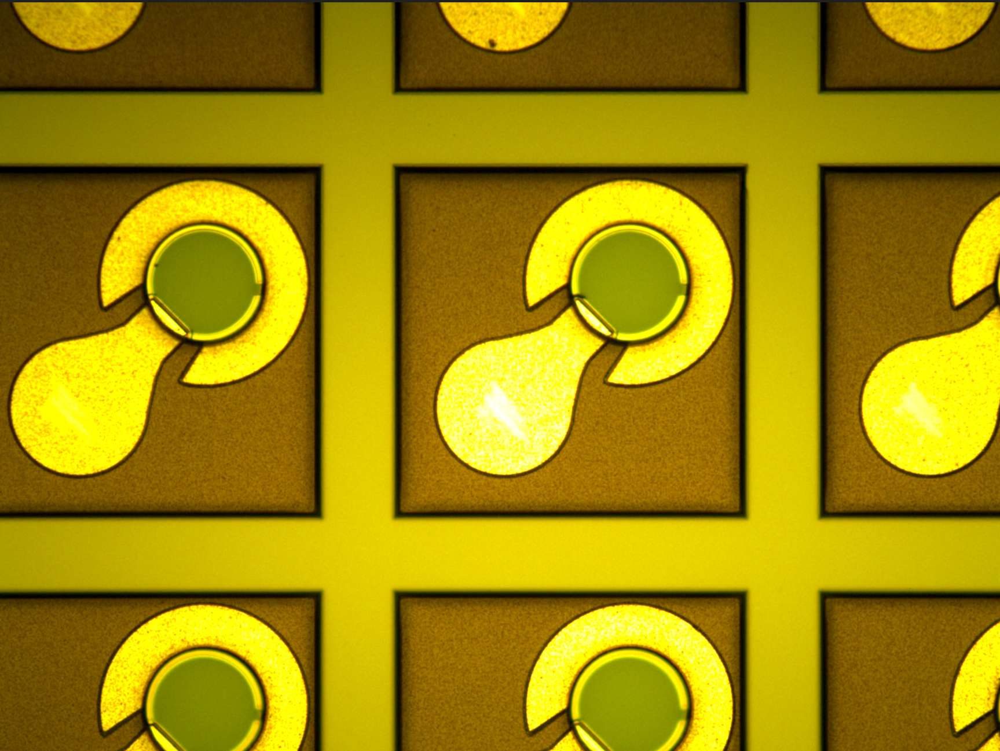 | 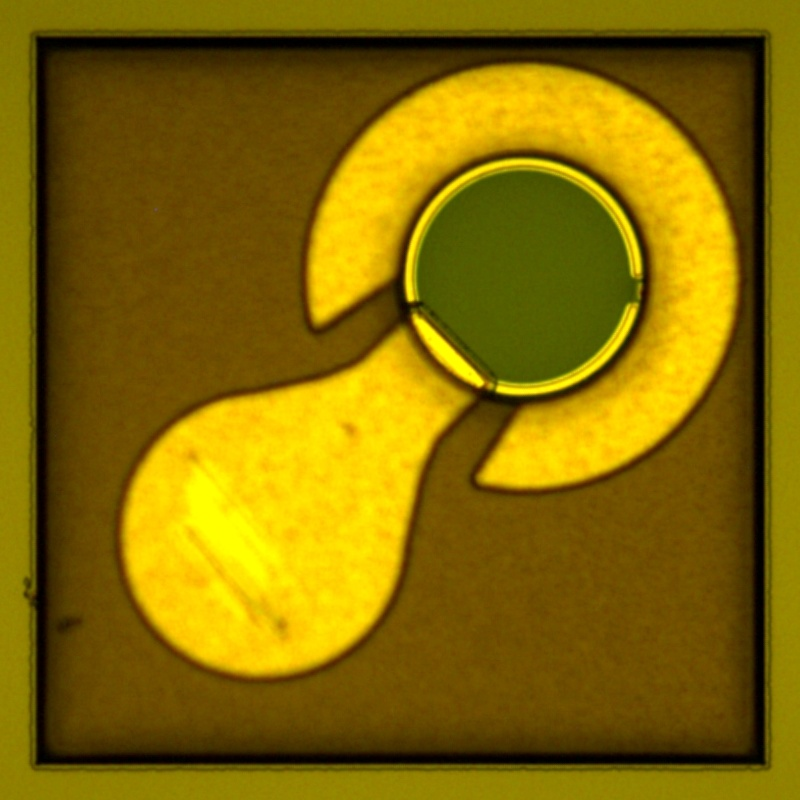 |

## 첫 선택 : AI 없이 잡아보기

### 초기 요구사항

첫 회의에서 Phosem은 결과물의 형태를 크게 제한하지 않았다. 웹/앱 방식이어도 괜찮고, 모델의 무게도 상관없다고 했다. 대신 적은 데이터(약 275장)로 여러 방식을 먼저 시험해 보고서를 내고, 이후 2천 장 규모의 데이터로 다시 학습해 최종 모델을 고르는 순서를 원했다. 보고서에는 FP, FN 정도의 지표가 들어가야 했다.

⇒ 필요한 걸 찾아 빠르게 적용하고, 빠르게 프로토타입을 확보하는 것이 첫 목표였다.

### 시도

처음 떠올린 방법은 AI가 아니었다. CUDA의 병렬 연산 장점을 살려 픽셀 단위로 불량을 구분하는 규칙 기반 방식이었다.

```c
이미지 -> 색별 영역 분리 -> 정상 픽셀 분포 기준 이상치 픽셀 검출 -> 이상 픽셀 blob 묶기 -> 기하학적 특징으로 분류
```

- 영역 분리 : 이미지에서 색별로 영역을 구분한다
- 적응형 밝기 이상치 검출 : 정상 픽셀 분포를 보고, 벗어난 RGB를 가진 픽셀을 검출한다
- 형상 기반 분류 : 검출된 이상 픽셀을 blob으로 묶고, 모양과 크기 같은 기하학적 특징으로 구분한다

이 방식을 고른 이유는 세 가지였다.

1. 이상 패턴이 고정되어 있을 것이라고 봤다
2. blob의 기하학적 특징으로 "왜 불량인지" 근거를 제시할 수 있다
3. AI가 돌지 않으므로 가볍고 빠르며, 같은 입력에 항상 같은 결과를 낸다

### 문제

1번 가정이 틀렸다. 실제 다이오드의 불량은 위치도 모양도 랜덤하게 발생했다. 규칙 기반 방식은 정해 둔 규칙 밖의 불량을 잡지 못한다. 또한 Crop 이후 들어오는 이미지 조각 역시 일정하지 않아서, 고정된 규칙으로 대응하기 어려웠다.

### 결과

- 신동호 학생의 양/불 판정 파트와 통합하려면 같은 계열의 모델이 필요했다
- 랜덤한 이미지 조각과 불량 패턴에 대응하려면 다양한 패턴을 학습한 모델이 필요했다

⇒ 규칙 기반 방식을 접고, CNN 기반 AI를 도입하기로 결정했다.

### 생각

아래 CNN 회고에서 "기술 선택의 근거가 부족했다"고 적었다. 하지만 돌아보니 근거가 없었던 것은 아니다. 규칙 기반과 AI를 비교했고, 이유를 세워 선택했다. 문제는 그 근거가 데이터를 보고 나온 것이 아니라 가정에서 나왔다는 점이다. "이상 패턴은 고정되어 있을 것이다"라는 가정은 데이터를 몇 장만 제대로 봤어도 바로 깨졌을 것이다. 나중에 카파시의 글을 읽고 EDA부터 다시 시작한 것도 결국 같은 이유였다.

또 하나 눈에 띄는 것이 있다.

- 규칙 기반 방식을 고른 이유 중 하나는 "가볍다"였다. 하지만 Phosem은 처음부터 모델 무게는 상관없다고 했다. 요구사항에 없는 장점을 근거로 삼았던 셈이고, 이후 쓸데없는 경량화에 시간을 쓴 것과도 이어진다.
- 반대로 버렸던 "설명 가능성"은 끝까지 다시 필요해졌다. 피드백에서도 불량에 대한 근거가 필요하다는 말이 나왔고, PatchCore에서 Anomaly Score가 가장 높은 격자의 (x, y) 위치를 확인한 것도 결국 "왜 불량인지"를 보여주기 위한 작업이었다.

⇒ 기술을 고를 때는 요구사항에 실제로 있는 조건과 데이터로 확인한 사실을 근거로 삼아야 한다. 그리고 버리는 방식의 장점이 정말 필요 없는 것인지 한 번 더 확인해야 한다.

## CNN 이론

불량 원인에 대한 Classification을 진행하므로, 이미지를 분류하는 AI가 필요했다. 당시 AI에 대해 전무했던 나는 이미지 분류를 진행하는 CNN을 기반으로 모델을 개발하였다.

### 이론

CNN은 Convolutional Neural Network의 약어로 합성곱 신경망을 의미한다. CNN은 여러 Conv Layer로 이뤄져 이를 구성한다. Layer는 1에서 점점 커질수록 깊은 층을 의미하며, 이는 층이 깊어질수록 더욱 복잡한 객체도 찾아낼 수 있다. 하나의 Layer에는 Feature map을 만드는 Kernel이 존재한다. 특정 값으로 이뤄진 Kernel은 사용자 정의에 맞춰 이미지 데이터를 슬라이딩 윈도우 방식으로 움직이며, 특징을 찾아낸다.

데이터가 Kernel을 거쳐 Feature가 나오게 되고, 이는 모여서 Feature Map이 된다. Kernel은 이미지와 모양이 같을수록 데이터와 비슷한 Feature map을 만들어낸다.

### 회고

당시에는 AI에 대해 무지하여, AI를 개발하는 방식이나 공부하는 법, 기술 선택과 그 근거가 부족했다. 그렇기에 무작정 이미지 분류에 가장 많이 쓰였으며, 레퍼런스가 많았던 일반 CNN모델을 선택하였다.
지금이라면 데이터에 BBox 라벨링을 통해 Yolo26으로 개발하는 것도 괜찮은 선택지 같다. 그 까닭은 크게 2가지가 있다.

먼저 EDA이다. 이는 데이터를 분석하는 과정으로 추후에 등장하겠지만, EDA의 중요성을 깨닫고, EDA를 진행하며 객체를 정형 데이터로 표현할 수 있도록 BBox 라벨링을 진행할 것이다. 그렇다면 성능이 좋은 Yolo 계열 AI를 사용할 수 있었다.

또한 나의 개발 프로세스에 대해 생각하게 되었다. 평소 임베디드를 개발하며 이것저것 분석하고, 비교했던 것을 바탕으로 했던 나지만, 이상하게 AI 분야에서는 그렇지 못했다. 그 까닭은 AI에 대한 기본기가 없었기 때문이라고 생각한다. 내가 AI 분야에서 뭐가 중요한지를 모르니, 실제로 AI의 판단에 대부분을 맡기는 선택을 했었다.
그렇기에 현재에는 AI에 대한 기본기를 배우며 어떤 걸 중요하게 생각해야 하는지, 또 어떻게 좋은 모델을 뽑는지 공부하고 있다.

## 첫 학습

첫 모델은 CNN 구조를 기반으로 하는 Resnet으로 학습을 진행했다. 당시에는 학습 데이터가 250개 정도로 매우 적은 양이었다. 처음 학습에서는 threshold, Memory bank, 아키텍처, 파라미터, 하이퍼 파라미터 등에 대해 배우며 개발을 진행했다.

불량 다이오드를 정상으로 판단하지 않도록 Threshold를 지정하고, 7 : 2 : 1 비율로 나눈 train data에 Bank를 만들어 저장하여 사용했다. 또한 초기에는 모델의 Layer는 [16, 32, 64]개의 채널을 가지도록 설정하여 사용했고, 98,178개의 파라미터 개수를 가지는 모델을 사용했다. 목표는 최소 accuracy 84%였다.

### 생각

이렇게 큰 모델에 많은 층은 필요가 없었다. 복잡하지 않은 다이오드 요소를 분류하는 데에 Resnet + 최대 64 채널 + 98,178 param은 꽤 무거운 모델이다. 하지만 당시에는 이런 개념이 잡히지 않았기에 개발을 진행한다.

### 첫 문제

AI 학습 시 가지고 있는 모든 데이터를 7 : 2 : 1 = Train : Val : Test로 나누어 사용했다. 하지만 데이터 자체 수량 부족 문제로 제대로 된 학습 자체가 불가했고, 결국 AI는 적은 데이터에서 학습을 진행하며 과적합이 발생했고, 30epoch에서 AP 78%를 보여주었다.

| | |
| --- | --- |
| 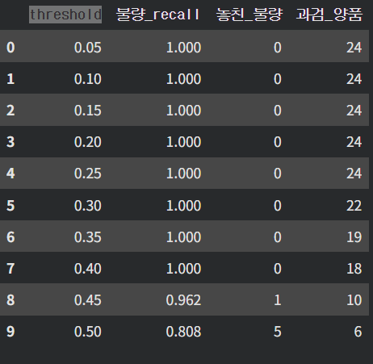 | 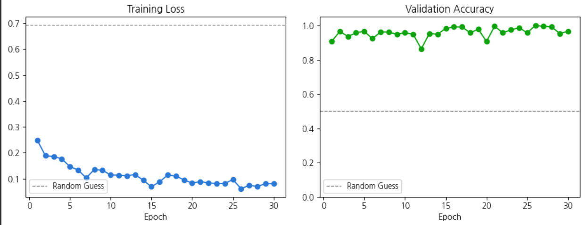 |

*Train loss가 크게 요동친다. CNN이 확인할 수 없는 크기의 먼지/스크래치까지 불량으로 라벨링된 데이터 품질 문제로 판단했다.*

threshold가 변하며 데이터를 판단하는데, 거의 모든 상황에서 recall이 1에 수렴한다.

### 시도

과적합 상태를 개선하기 위해 몇 가지를 시도했다.

1. threshold 변화 : 반도체 소자 검증에서는 threshold를 느슨하게 둘 수 없다. 0.5를 기준으로 했을 때 놓친 불량이 5개였고, 이는 모델/학습 과정 자체에 문제가 있다는 의미였다.

    

2. Memory Bank : 양품 93장에서 74,400개의 Feature (한 장당 800개)를 뽑아 Bank를 만들고, 새 이미지와 대조했다. 하지만 Accuracy는 오히려 69.6%로 떨어졌다. 점수 분포를 보니 같은 점수대에 불량과 양품이 겹쳐 있었다.

    
    
    

3. Bank 개선 : 원인은 세 가지였다.
    - 표본이 너무 적어 정상의 범위를 담지 못함
    - PATCH_INPUT_SIZE + pool_kernel 조합이 정밀한 검사를 막음
    - Layer 1만 사용해 엣지, 미세한 밝기 변화만 잡음

    ⇒ 데이터 증강으로 표본을 늘리고, 업샘플을 bilinear에서 nearest로, pool_kernel을 3에서 1로 바꾸고, Layer 2, 3을 함께 사용했다.

    

### 결과

개선 후 train-set에서는 89%의 accuracy를 찍었지만, test-set에서는 다시 69%로 돌아갔다. 편향된 데이터에서 Bank를 늘려도 모델만 무거워질 뿐, 과적합 상태에서 뽑은 특징은 의미가 없었다.


⇒ 목표치인 84%에는 한참 못 미쳤다.

## 추가 데이터

처음 250장을 받고, 그 이후부터 주기적으로 데이터가 보급되었다. 데이터는 포셈에서 직접 다이오드 사진을 촬영하여 라벨링 후 전달하는 방식으로 보급되었다. 하지만 보급된 데이터는 편향되었다는 문제가 있었다. 실제 다이오드를 촬영하다보니 정상 다이오드의 데이터가 불량 다이오드의 데이터보다 훨씬 많은 문제가 발생했고, 이는 overfitting을 야기했다.

실제로 보급된 데이터는 6 : 1 = 양품 : 불량 비율을 보여주었다.


## 멘토링

팀은 주기적으로 보고서를 작성하여 현재 상황을 담당 교수님께 전달드린다. 당시 과적합 문제와 데이터 불균형 문제를 보고서에 작성하여 제출하고, 다른 1기 선배님께 AI에 대한 멘토링을 받게 된다. 멘토링은 염세현 학생이 발표하고, 다른 학생과 선생님이 참관하며, 1기 선배님은 발표를 보고 피드백을 진행해 주신다.

### 문제

1. 간단한 이미지 분류에서 Resnet같이 큰 모델을 사용할 필요가 없음
2. Resnet에서 Feature 수도 크게 설정하니 파라미터가 너무 많음
3. 데이터 자체 품질이 너무 낮음

### 업데이트

각 Layer의 Feature 수를 대폭 감소시켜, 전체 Param을 줄였다. 또한 AdamW를 사용하여 Learning Rate 부분을 개선하였다. 옵티마이저의 종류 중 하나인 AdamW는 학습 가중치를 조정하며 최소 오차 지점까지 가는 데에 연산에 보정을 해준다. AdamW는 기존 Adam 식에 Weight decay를 추가하여 학습을 진행하며 바뀐 값이 급격한 변화가 일어나지 않도록 상한을 제어하는 것이다.

### 받은 피드백

과적합 문제 이후 받은 피드백 중 이후 개발에 영향을 준 내용은 다음과 같다.

- 기본 구조 : Conv → Batch Normalization → ReLU → Max Pooling이 기본 컨볼루션 블록이고, 그 뒤에 Average Pooling → Flatten → FC를 붙인다
- 데이터 리밸런싱 : 양품 1000개, 불량 100개라면 첫 epoch는 불량 100개 + 양품 1~100, 다음 epoch는 같은 불량 + 양품 101~200 식으로 돌린다. 이후 데이터 증강을 적용해야 과적합을 막을 수 있다
- 데이터 환경 : 계속 바뀌는 촬영 환경은 좋지 않은 입력이고, 불량에 대한 근거가 필요하다
- 개발 방향 : 채널 크기, kernel, 망 깊이를 기계적으로 스캔해서 일부러 over-fitting을 만들고, 원하는 accuracy를 맞춘다

### 다시 설계

피드백을 바탕으로 학습 부분을 다시 짰다.

- sliding rebalancing : 같은 수의 양품/불량으로, epoch마다 양품만 바꿔가며 학습
- early stopping : Validation 지표가 일정 epoch (patience 7) 동안 나아지지 않으면 학습 중단
- 지표 추가 : Accuracy 외에 recall, precision을 함께 기록
- AdamW : sliding rebalancing으로 같은 불량 사진을 반복 학습하므로, weight decay로 특정 특징에 과의존하지 않게 막음

모델 크기는 너비 (Output channel) \* 깊이 (layer 수)로 파라미터 수를 조절하며 스캔하기로 했다. [8, 16]부터 [16, 32, 64, 128]까지 6가지 구성을 정하고, 모델 사이즈만 바꾸는 변인 통제와 2~3회 반복 평균으로 실험을 설계했다.

### 회의 결과

파트 역할도 다시 나눴다.

```c
New Data -> 3*3 Crop -> 양/불 판정 (신동호) -> 양 : pass / 불 : 불량 근거 판단 (염세현 : 스크래치, 이물질 등) -> 접합부 문제 -> pass
```

## 두번째 만남

멘토링 이후 나는 기존 모델의 부족함을 느끼고 여러 개선을 진행한다. 하지만 당시에 데이터 품질을 위해서 다시 라벨링을 진행하는 상황에서 결괏값까지 뽑아내지 못하고, 보고서를 작성하게 된다. 그렇게 에트리에 방문하여 담당 교수님께 여러 피드백을 받았다.

### 피드백

담당 교수님께서는 여러 조언을 해주셨고, 그 중 기억에 깊게 남은 네 가지를 정리하려 한다.

1. 결과가 있어야 성공/실패이다
2. 과정은 학생에게나 중요하다
3. "열심히 노력함"은 상대적이지 않다
4. 정답인 길을 아는지가 중요하다

먼저 결과가 있어야 한다는 의미는 말 그대로이다. 무언가를 수정하고, 엄청난 기능을 추가하는 것은 아무 의미가 없다. 그걸로 도출된 결과물의 상태/값/효과 등으로 평가되는 것이다. 어떤 프로젝트에서 A기능을 넣은 것은 발표 시에 "기능 도입 성공"이 아니다. "기능 도입 시도"인 것이다. 이 시도를 성공으로 이으려면 결과가 필요함을 잊지 말아야 한다.

다음은 과정이다. 우린 학생이고 겪고, 배우는 과정이기 때문에 다양한 시도를 하는 것을 선호했다. 이것들은 포트폴리오/이력서에 적을 좋은 소재이기 때문이다. 하지만 실무는 어떤가? 전혀 그렇지 않다. 어떤 AI 모델을 쓰든, 어떤 똥 같은 오픈소스를 쓰든 됨/안 됨 이 두 결과 중 하나로 이어질 수 있고, '됨'이라는 결과로 이어짐이 중요하다.

또 열심은 하고 싶은 말이 많다. 먼저 손영달 선생님, 에트리 교수님의 말을 빌리고 싶다. 열심의 한자 뜻은 뜨거운 열, 마음 심 한자를 사용한다. 즉 심장이 뜨겁도록 무언가를 하는 것이다. 나는 인생을 살면서 게임을 열심히 했던 것 같다. 테라리아 같은 느낌이다. 정말 심장이 뜨겁게 좋아했고, 열심히 했다. 중학생 때는 여기에 쏟았던 시간이 부질없었고, "무슨 의미지?", "시간 버렸네" 라는 생각을 했다. 적어도 지금은 생각이 바뀌었다. 무언가를 열심히 해본 경험은 새로운 일을 열심히 하는 방법에 대한 가이드라인이 되었고, 이를 바탕으로 나는 이번 고등학교 2학년 여름방학을 열심히 보낼 것이다. 이번 방학이 끝나고 내 심장이 뜨거웠으면 좋겠다. 또한 교수님은 본인의 제자분을 예시로 말씀해 주셨다. 제자분이 원래 [유튜브 → 게임 → 운동 → 식사 → 자유시간]같은 루틴을 보냈다고 했을 때 자유시간에 일을 하는 것이 열심히가 아니라고 하셨다. 원래 놀았던 시간에 뭔가를 했기 때문에 열심히 했다고 느끼는 것뿐. 이건 틀렸다. [일 → 일 → 운동 → 식사 → 일] 이것이 "열심"이다. 열심이라는 행동은 상대적이지 않다.

마지막으로 정답인 길을 알아내는 것이 중요하다. 앞서 말했듯 무수한 배움이 있었어도 정답이 틀렸다면 회사는 의미가 없다고 판단한다. 그렇기 때문에 무엇이 정답인지 알아야 한다. 내가 하는 길이 정답인지 알고, 시간을 투자해야 성과가 나온다. 그렇기에 이 정답 ( = 해답)을 찾는 것이 중요하다고 느꼈다. 만약 이 과정을 발표한다면, 이런 느낌이다.

1. 3개의 아키텍처를 고안했습니다.
2. 10개 중에 가장 유력한 3개의 아키텍처를 고안했고, 그중 A안이 유력한 방안입니다.

1번은 답이 없어 보인다. 그래서 어쩌라는 건지도 모르겠고, 정답과 가까워졌는지도 모호하다. 반면 2번은 정답의 실루엣을 찾았고, 찾기 위해 시도 중인 것으로 보인다. 그렇다 이 길을 잘 선택해야 한다. 정확한 답은 없지만, 목표에 가까운 답은 있다

### 카파시의 발표

그렇게 피드백을 받고, 생각보다 더딘 AI 개발 진행도에 내 공부 방식 자체에 문제를 느꼈다. 애초에 어떤 배경지식도 없이 일단 개발부터 시작하며 배우는 건 무작정 도전하기 쉬운 일이 아니었다. 그렇게 AI 개발 방식 자체를 공부해야겠다는 필요성을 느꼈다.
그렇게 찾아본 글은 Andrej Karpathy의 ML을 하는 방법에 관한 글이었다. 카파시는 다음과 같은 말을 하며 해당 글을 쓰기 시작한 이유에 대해 말한다.

1. "신경망 학습은 새는 추상화이다." 신경망은 라이브러리 몇 줄로 해결하는 문제가 아니고, 원리를 이해하지 못하면 의미가 없다.
2. 논리가 틀린 버그에서 학습을 하며 AI 자체 성능이 조금씩 떨어진다.

카파시는 총 6단계로 AI 개발을 쪼개어 설명했다. 가장 먼저 데이터 EDA이다. 몇 시간을 투자하여 데이터를 직접 눈으로 보고, 문제를 파악하고, 분석하는 것이다. CNN 같은 이미지 관련 AI 알고리즘은 이러한 방법이 더 중요하다. 데이터를 직접 보고 문제를 느낀 후 적용할 Filter를 고르고, 집중할 ROI 영역을 찾아내고, 불량 데이터가 가지는 특성을 확인하면, AI가 어떻게 구상되며, Output이 어떻게 나와야 할지 생각할 수 있다.
그다음으로는 가장 큰 모델에서 학습을 돌리는 것이다. Resnet 같은 큰 모델에서 학습을 돌리고, 검증하여 데이터 자체의 문제를 파악하고, 이 과정에서 적은 데이터로 일부러 과적합을 발생시켜 데이터의 신뢰성을 찾는 것이 중요함을 깨달았다. 적은 데이터에서 과적합이 일어나지 않고, Resnet 같은 큰 모델이 100%에 수렴되지 않게 특징을 판별하지 못한다면, 데이터 자체에 문제가 있는 것이다. 이후 TTA나 앙상블, 지식 증류 같은 방법을 최종적으로 도입하는 개발 방식을 설명했다.

실제로 이 글을 읽고, 데이터를 제대로 진득하게 분석해본 적이 없다는 생각에 1시간을 내리 데이터 분석에 사용하였다. 분석에서는 다음과 같은 내용을 분석했다.

- 데이터 크기
- 이미지 해상도
- 불량 원인 구분
- 찾기 어려운 불량
- 찾기 쉬운 불량
- ROI 영역이 필요한 부분
- 색에 민감도
- 밝기 민감도

여기서 얻은 정보들로 ROI를 추가하고, 찾기 어려운 문제에 대해 TTA 방식을 추가했다. 또한 색마다 다른 문제를 표시하므로, 색 Filter를 넣지 않고, 밝기 Filter를 넣어 성능 검증 테스트를 진행하였다. 이러한 EDA는 프로젝트에서 뭘 해야하는지 정확히 이해하는 데에 도움을 주었고, 어떤 문제가 심각하고, 다시 분류해야 하는지 알 수 있었다.

## 이후 모델 개발

이후 모델 개발에는 쓸데없는 경량화, 이론 공부보다 개발에 집중했다. 교수님이 다음 목표로 주신 것은 AP 0.8 이상이었다. 또한 평가 지표로 AUROC ( = AUC)를 사용하는 것이다. 이는 threshold에 국한되지 않으며, 모델 자체 성능이 우수한 편이고, 80% 확률로 불량을 잡아낼 수 있는 모델을 의미한다. 이 개발 과정에서 데이터는 총 4300개가량 되었다. 우리는 데이터 사용을 위해 다시 라벨링 작업을 진행하고, Crop 이미지를 모아 학습을 진행했다.

### 현실

쉽다고 생각했던 분류 개발은 순조롭게 진행되지 못했다. 가장 큰 이유는 데이터의 불균형이었던 것 같았다. 아래 막대 그래프는 데이터가 추가 보급되어 4,300개가량이 되기 전 데이터이다. 보시다시피 AI가 불량의 원인을 학습할 수 있을 정도로 많은 데이터를 제공받지 못했다. 하지만 이는 실제 현장에서 쓰이는 데이터와 동일했고, 현장에서도 이걸 구분할 수 있어야 하기 때문에, 개발은 진행되었다.

개발을 진행하며 다양한 기법을 적용하게 되었다

- ROI : 특정 부분 집중 영역 생성
- TTA : 여러 형태 입력으로, 예측 성능 높이기
- MIL : 데이터를 Patch로 쪼개어 Bag에 넣고 Bag만 Labeling하여 학습
- Ensemble : 각기 다른 모델에서 추론 후, 예측값 결합

하지만 불량 자체 데이터와 양품 데이터는 충분하게 제공받았기에 실제로 양/불 판단 모델은 원인 예측 모델보다 성능이 좋게 나왔다.

| 데이터 수 측정 | 모델 AP |
| --- | --- |
| 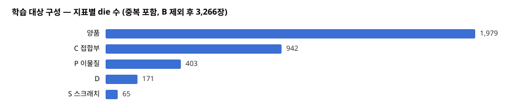 | 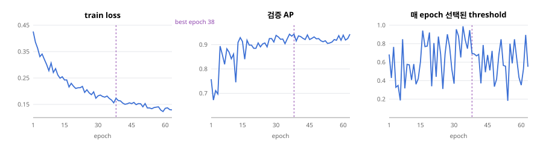 |

```c
// 실제 분류 체계
- C : Connect (접합)
- D : Destroy (파손)
- P : Particle (이물질)
- S : Scratch (스크래치)
- B : Break (훼손)
```

### MIL

처음에는 die 이미지에서 무작위로 patch를 뽑고, die의 라벨을 patch에 그대로 붙여 학습했다. 하지만 결함은 국소적이다. 한 die에서 8장을 뽑으면 1장에만 이물질이 있고 나머지 7장은 정상일 수 있다. 이 라벨 노이즈 때문에 단일 분류 학습이 무너졌고, 판별이 특정 클래스로 몰렸다.

⇒ 라벨을 patch 하나하나가 아니라 patch 묶음 (bag) 전체에 붙이는 MIL로 구조를 바꿨다.

- bag : die 한 장에서 뽑은 patch 8장 (ROI 2장 + 무작위 6장)
- MIL 가정 : bag이 불량이면 그 안에 불량 patch가 최소 1장은 있고, bag이 정상이면 patch 전부 정상
- 학습 : patch 중 가장 높은 점수 (max logit)에 die 라벨로 BCE를 계산
- 다중 라벨 : P/S/D/B/C 5개 클래스를 sigmoid로 각각 판단하고, PD 같은 조합 클래스는 동시 양성으로 분해 ⇒ 희귀 클래스도 학습에 기여
- ROI : C (접합) 결함은 위치가 고정이라 집중 영역으로 지정

## Anomaly Detection

### 배경

그렇게 다양한 알고리즘을 공부하고, 적용하며 모델을 만들어 AP 0.93 모델을 개발하였다. 하지만 이는 Phosem이 원하는 모델이 아니었다. 해당 모델은 초반에 우리가 직접 라벨링했던 데이터 4300여 장으로 학습되어 도출된 것이었다. 그러므로 Phosem은 현재 알고리즘에 누구도 건드리지 않은 새로운 데이터로 학습 후 채점을 제안한다.

돌아보면 여기에는 소통의 문제가 있었다. 원래 우선순위는 PatchCore로 불량을 먼저 잡는 것이었고, `분류 + classification` 은 그 이후의 일이었다. 하지만 이를 잘못 이해해 분류 모델을 먼저 개발했고, classification을 위해 라벨링도 직접 다시 진행했다. 회사는 정해진 라벨을 임의로 바꾸는 것을 원하지 않았다.

### 결과

그렇게 3609장으로 새로운 학습을 진행하고, 채점하게 된다. 아래 사진을 보면 0.69 ~ 0.7 정도의 성능을 가지는 모델이 나오게 되었고, 실제 결과는 다음 ROC 곡선 사진과 같다. 이후 이 모델로 라벨링되지 않은 데이터를 넣어 실제 채점을 진행했고, AUROC는 0.59 정도였다.

| | |
| --- | --- |
| 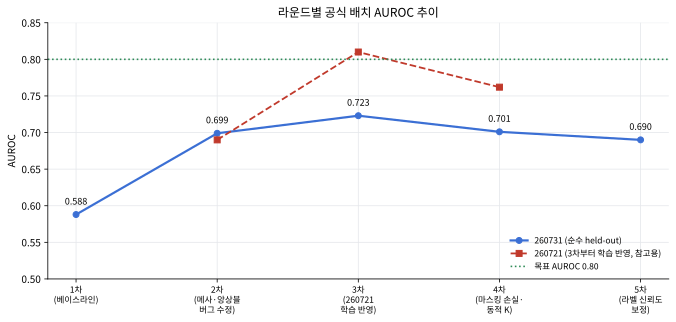 | 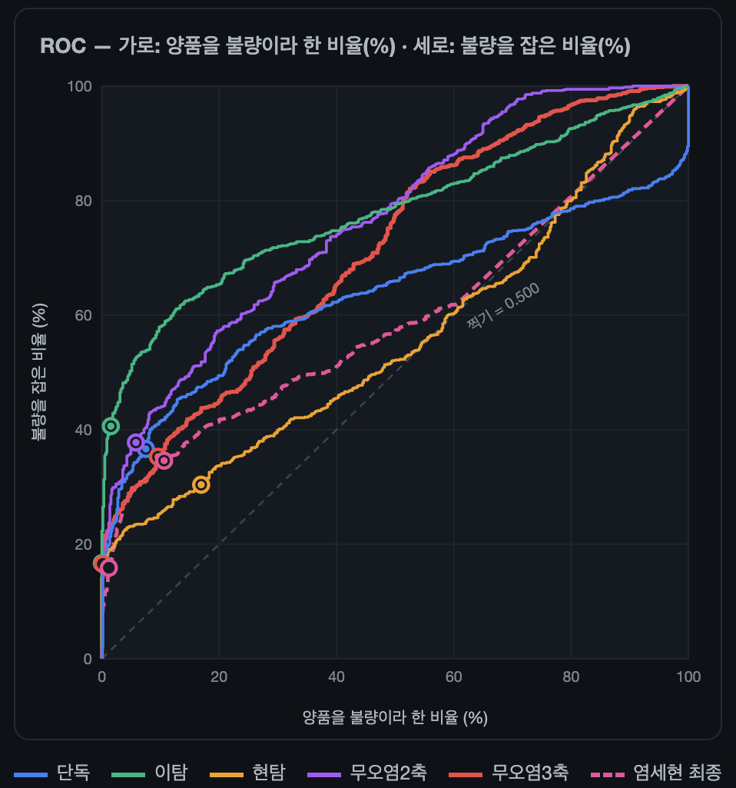 |

### 제안

여기서 담당 교수님께서는 Anomaly Detection 모델을 하나 제작하여 기존 모델에 부족한 부분을 보완하는 축을 개발하자는 의견을 제안해 주셨다.

### 개발

개발 이전에 Anomaly Detection에 대한 많은 공부를 진행했다. 어떤 방식으로 판별되며, 어떤 종류의 알고리즘으로 나뉘며, 데이터에 따라 어떻게 개발해야 하는지 공부했고, 이를 파이프라인에 녹여냈다. 이상 탐지 ( = Anomaly detection)는 특정 Feature vector (Bank)와 새 데이터의 특징을 비교하여, 이상을 탐지하는 기법으로, 정상 데이터에 대한 Feature vector가 필요했다.

초기 제안서에는 300개의 정상 이미지를 뽑아 Feature vector를 제작하는 것을 목표로 했었다. 이는 데이터를 하나씩 분석하며 EDA를 하고 보다 완벽한 정상 set을 만들 수 있지만, 시간이 오래 걸리고, 희귀한 정상 다이오드에 대한 학습을 할 수 없었기에 위험했다. 그렇다고 모든 데이터로 Feature vector를 만들자니, 오류가 섞이며 만들어지는 Bank를 믿을 수 없었다. 그렇기에 처음에는 다음과 같은 파이프라인을 계획했다.

```c
3,609장 중 무결한 2,142장에서 Feature vector 추출 -> Outlier 방식을 통해 2,142장에서 뽑은 Feature vector와 2,142장을 한 장씩 비교 (본인 제외) -> 이상이 탐지된 데이터는 Set에서 제외
-> 정상 데이터 Feature vector 확보 -> Novelty 방식을 위해서 Bank 확보 -> PatchCore 모델 개발
```

- Outlier : 한 데이터셋에서 같은 데이터를 비교하며 이상 데이터를 찾아냄
- Novelty : 한 데이터셋에서 Bank를 얻고, 새로운 데이터에 이상을 탐지
- Feature vector : 데이터에서 추출한 특징 벡터

### Bank 설계

- 특징 추출 : 교수님 제안으로 Resnet50의 Layer 2, 3을 사용했다. Layer 1은 색, 단순 패턴이고 Layer 4는 고수준 의미 특징이라 너무 저/고 수준이다. Layer 2는 작은 흠집, 질감, 모서리를, Layer 3은 형태와 부분 구조를 잡기 때문에 다이오드 결함에 맞았다.

    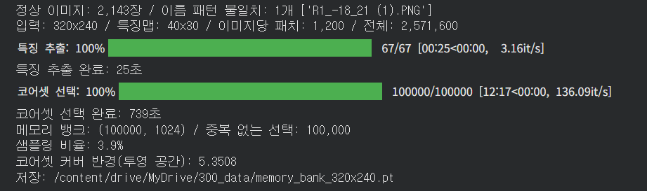

- 입력 해상도 : 868 \* 868로 키웠다. 작은 결함이 뭉개지지 않고, MIL 학습 해상도와 비슷하며, 기존 320 \* 240에서 찌그러지던 수광창이 실제 비율에 가깝게 들어온다.
- Coreset : 214만 개의 Feature 중 전체를 대표하는 10만 개를 골랐다. 한 점에서 가장 먼 점을 고르고, 다시 그 점에서 가장 먼 점을 고르는 과정을 10만 번 반복한다. 커버 반경은 7.0770이었다.

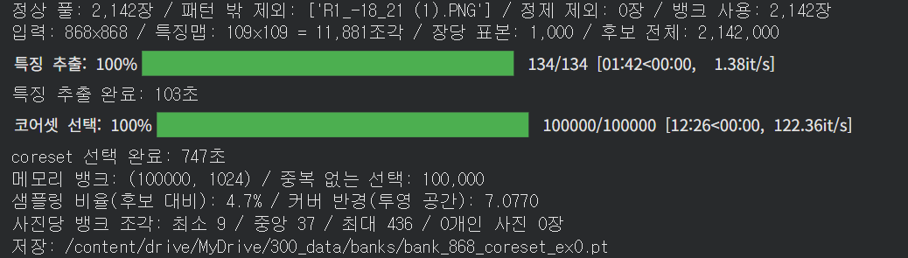

다음과 같이 Vector를 뽑아냈고, 이는 정상의 Feature이다.

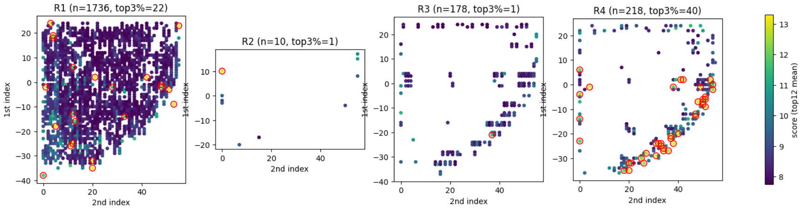
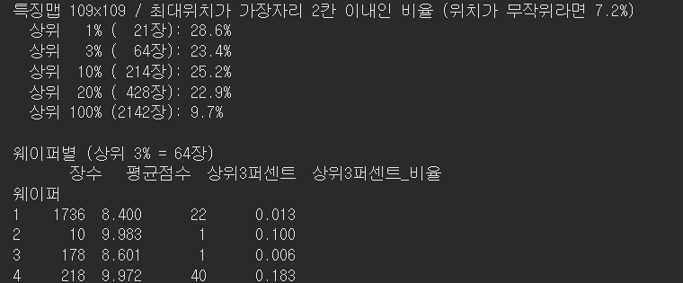

Feature vector들을 히트맵으로 찍어보면 위 사진과 같다.
Outlier 순위 상위권에서 die 가장자리가 영향을 준 비율은 22 ~ 26%였고, 나머지 74 ~ 78%는 내부 영역이었다. ⇒ 가장자리 때문에 생긴 문제는 1/4 정도이다.

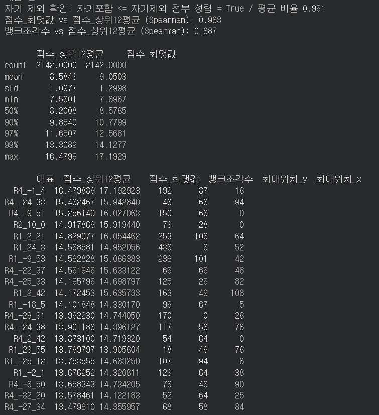

R4로 라벨링된 데이터는 R1으로 라벨링된 데이터보다 문제가 많았다.
하지만 이는 문제가 아닌 정상 상황이었다. 기존 MIL 모델에서도 R4 라벨링 데이터의 불량 확률이 높았다. 그 까닭은 다이오드 구분 난이도 차이이다. 다이오드는 촬영 시 총 4번을 촬영한다. 첫 촬영에서 사용 가능한 좋은 데이터가 나올 시 R1으로 라벨링하고, 그렇지 않은 경우 R2, R3로 이동한다. 가장 어려운 다이오드 모양의 경우 R4가 되는 것이고, 그렇기에 불량으로 판단되는 지표의 값이 높았던 것이다.

| R1 | R4 |
| --- | --- |
| 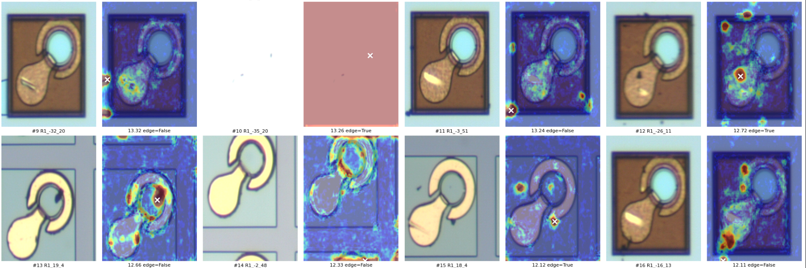 | 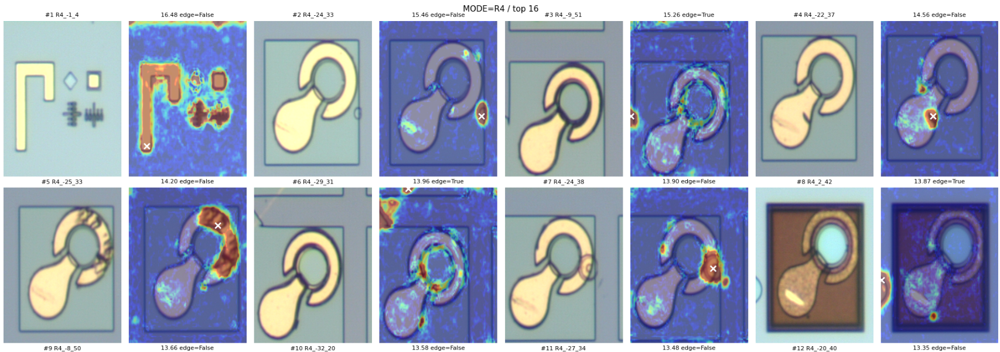 |

R4에는 다음 사진과 같은 정렬 표식들이 포함되어, 그중 4장을 제외하고 다시 Feature를 뽑아냈다. 정렬 표식은 총 7장이지만, 3장은 채점된 CSV에 점수가 있어 정상 Feature 추출과 Bank 테스트에 도움이 되므로 남겼다.

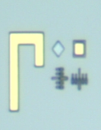

### 계획 변경

처음 계획은 MIL과 Outlier가 불량이라고 판단한 데이터를 Set에서 빼는 것이었다. 하지만 MIL은 2,142장 안에서 불량을 거르는 데에 도움이 되지 않았다.

| 구역 | 장수 | 불량률 | MIL AUROC | 이탐 AUROC |
| --- | --- | --- | --- | --- |
| 1,467 전체 | 1,467 | 60.1% | 0.596 | 0.779 |
| 함께 고른 333 | 333 | 86.8% | 0.805 | 0.867 |
| 우리(MIL)만 567 | 567 | 45.3% | 0.639 | 0.711 |
| MBK만 567 | 567 | 59.3% | 0.517 | 0.715 |

2,142장은 MIL이 불량으로 분류한 상위 900장에 들지 못한 데이터이다. MBK 모델에서만 상위 900에 든 567장을 보면 MIL AUROC가 0.517로, 사실상 찍기 수준이었다. ⇒ MIL은 상위 900장 아래에서는 판단을 신뢰할 수 없어 Bank 정제에서 제외했다.

또한 교수님께서 R4 정렬 표식만 뺀 Set으로 Bank를 먼저 만들고, 빠르게 PatchCore를 완성하는 것이 우선이라고 하셨다. 그래서 Outlier로 이상 데이터를 빼는 단계는 다음으로 미루고, 아래 흐름으로 진행했다.

```c
2,142장 - R4 정렬 표식 4장 -> New Feature vector (Bank) -> 1,467장 채점 -> MIL과 결합 -> 모델 테스트
```

정렬 표식을 뺀 Bank의 커버 반경은 7.0770에서 7.0693으로 줄었다. 단 4장을 뺀 것이라 예상대로 큰 차이는 없었다.

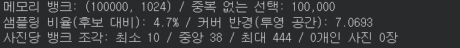

### 지표 보기

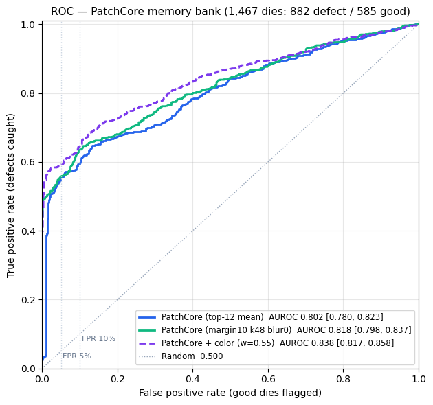

- ROC curve : 지도 분류 모델에서 성능을 검증하는 데에 사용하는 그래프이다.
    - X축 : 실제로 정상인데 불량으로 판단한 비율 (1 - 특이도, FPR)
    - Y축 : 실제로 불량 중 불량으로 판단한 비율 (민감도)

    | 실제 상태 | 불량이라고 예측 | 정상이라고 예측 | 합계 |
    | --- | --- | --- | --- |
    | 불량 | 60개 (TP) | 40개 (FN) | 100개 |
    | 정상 | 20개 (FP) | 80개 (TN) | 100개 |

    - Y : 0.6
    - X : 1 - (0.8) = 0.2
- AUROC : ROC curve의 곡선 아래 영역
    - ROC curve는 threshold에 따라 성능을 나타낸 지표로써, AUC는 여러 threshold에 걸쳐 모델의 불량을 잘 찾으며, 정상 오판률을 낮게 판단하는 좋은 모델이다.

        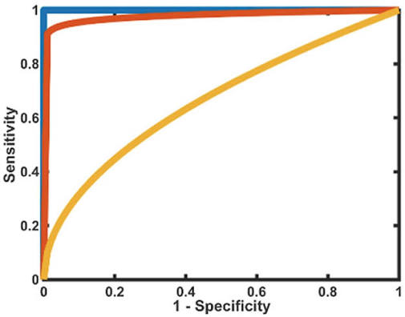

## 모델 비교

이렇게 정제된 데이터에서 뽑은 Feature vector로 PatchCore 모델을 개발하였다. 그 후 MIL 모델과 성능을 비교하여 하나를 선택해야 했다.

- PatchCore 모델만 사용할 것인가?
- MIL 모델만 사용할 것인가?
- 두 모델을 합쳐 사용할 것인가?

### 비교

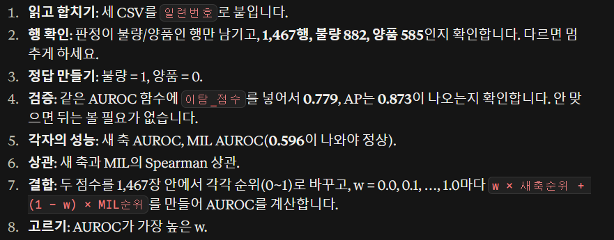

당시에는 1,467장의 데이터가 정확한 라벨과 매칭된 데이터 셋이었다. 그렇기 때문에 MIL 모델로도 1,467장은 판별하고, 이를 기준표로 채점한 CSV를 가지고 있었다. 이후 PatchCore 모델 역시 같은 테스트, 검증을 진행하였고, 두 모델을 비교한 그래프가 아래 사진과 같다. 그래프에서 New axis가 PatchCore 모델이고, Fusion은 두 모델의 예측값을 조합한 결과이다. ROC curve와 PR curve에서 New axis와 Fusion 모델이 좋은 성능을 보였다.

Fusion 모델에서 가장 좋은 두 모델의 조합 비율은 8 : 2임을 그래프로 확인할 수 있다. 두 모델을 합치기 전에, 합칠 가치가 있는지부터 확인했다. MIL은 불량 확률, PatchCore는 이상 점수라 단위가 다르다. 그래서 점수를 정규화하고, 두 점수를 순위로 바꿔 비교하는 Spearman 상관계수를 구했다. 결과는 0.173으로, 두 모델이 서로 다른 기준으로 판단한다는 뜻이다. 교수님은 0.3 이하라면 합쳤을 때 서로의 판단 오류를 메워 성능이 오를 것이라고 보셨다. ⇒ 합칠 가치는 확인했고, 남은 것은 조합 비율인 W를 정하는 것이었다.
그렇기 때문에 `MIL model : New axis = n : 1 - n` 식으로 n을 바꿔가며 AP가 가장 높은 조합을 찾아냈고, `MIL model : New axis = 2 : 8` 비율이 가장 좋은 Fusion 모델의 W값임을 알 수 있었다.

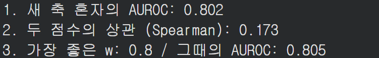

- ROC curve : 구분 성능 그래프
- PR curve : Precision-Recall 그래프
    - Precision : 예측한 불량 중 실제로 얼마나 불량인가?
    - Recall : 실제 불량 중 모델이 얼마나 찾아냈는가?

| | |
| --- | --- |
| 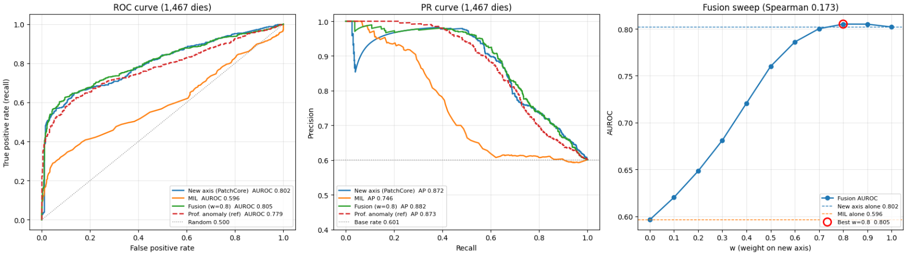 | 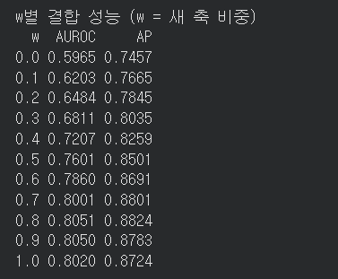 |

이렇게 개발된 PatchCore + MIL 모델을 Phosem은 사용하기로 결정하였다.

## Filter

PatchCore 단독으로 AP 0.805를 달성했다. 남은 성능을 끌어올리기 위해 Filter를 추가하려 한다. Filter는 필요한 정보는 남기고 불필요한 정보는 걸러낸다. Novelty 방식에서 Bank를 뽑을 때 불필요한 정보를 거르면 더 좋은 Bank를 얻고, PatchCore 성능도 오를 것이라고 생각했다.
하지만 아무 Filter나 넣을 수는 없다. 예를 들어 특정 색을 걸러냈는데 그 색이 바로 불량의 단서였다면 알아챌 수 없다. 그래서 현재 PatchCore가 틀리게 판단한 데이터를 EDA로 분석해서, 넣을 Filter를 고를 예정이다.

## 회고

### 목표 대비

- 첫 학습 : 목표 accuracy 84% → 최고 78% (test 69%)
- 분류 모델 : AP 0.93 (직접 라벨링한 데이터 기준) → 새 데이터 0.69 ~ 0.7, 라벨 없는 데이터 AUROC 0.59
- 이상탐지 : 목표 AP 0.8 → PatchCore 단독 AP 0.805
- Fusion (MIL : PatchCore = 2 : 8) : 최종 AUROC / AP → ?

<details>
<summary>보고서</summary>

| | |
| --- | --- |
| 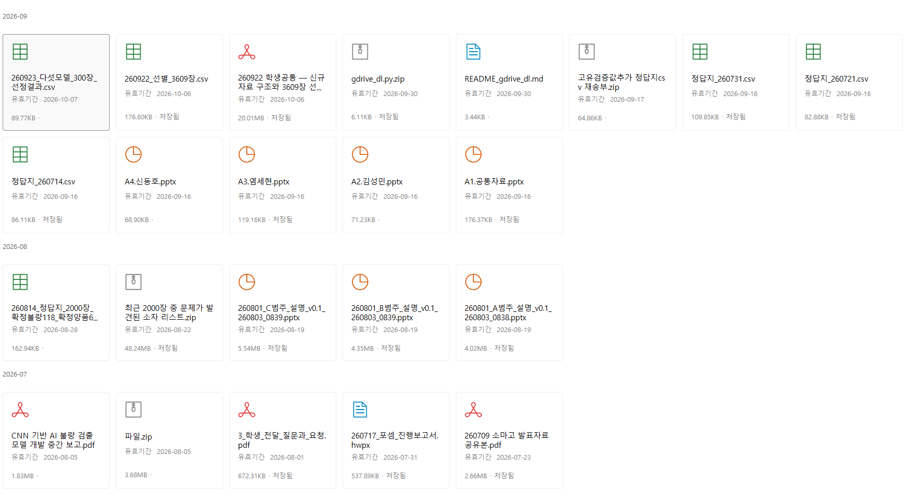 | 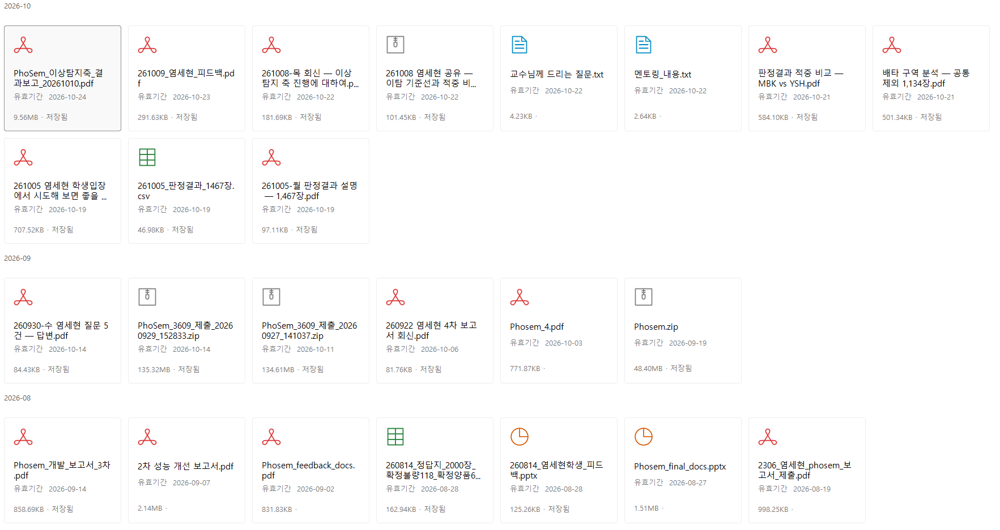 |

</details>
