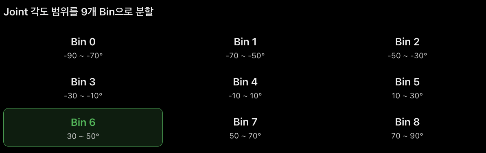

FK : forward kinematics, joint 값을 입력값으로, End-effector를 구하는 방식

IK : inverse kinematics, end-effector를 기준으로 joint값을 맞춰 찾아가는 방식

---

End-Effector 이동량이나 Joint 제어값은 원래 연속값이다. 하지만 Trnserformer 모델은 이산 토큰 시퀀스를 다루는 데에 능숙하다.

즉, 정해진 값들이 순서대로 나영된 토큰 을 더 잘 처리한다는 의미이다. 그러므로 VLA는 동작들을 bin 단위로 나누어 사용한다.



이러한 방식으로 Action을 tokken으로 관리할 수 있다.

결국 연속적인 벡터 값들의 변화를 LLM이 이해 가능한 이산적인 값들로 나누어 Action에 사용하는 것을 action tokenization라고 한다.

( = 여러개로 나뉜 bin 중 1개의 bin = 1개의 action token)

- L은 lower bound의 약자로, 해당 값이 가질 수 있는 최솟값이다.
- U는 upper bound의 약자로, 해당 값이 가질 수 있는 최댓값이다.

이는 물리적으로 표현 불가능한 부분들에 대한 방지를 위해서 상한과 하한이 정해진다.

Action이 벡터에 나열되어 있을 것이다.

```py
[x, y, z, roll, pitch, yaw]
```

위와 같은 벡터는 6차원이다. 이러한 차원이 가질 수 있는 값의 상한/하한이 L/U이다.

- L : -0.05
- U : 0.05

위와 같은 상황에서 bin을 256개로 쪼갠다면,

$$
( u - l) / bin
$$

= 0.1 / 256 = 0.00039

bin 하나가 감당하는 구간의 폭을 의미한다. 256 bins는 적절한 해상도로써, 많이들 사용하는 bin을 나누는 정도이다.

| Bin 번호 | 담당하는 값의 범위 |
| --- | --- |
| Bin 0 | -0.05 \~ -0.049609375 |
| Bin 1 | -0.049609375 \~ -0.049218750 |
| Bin 2 | -0.049218750 \~ -0.048828125 |
| ... | ... |
| Bin 255 | 마지막 구간 \~ +0.0 |

변하는 값 x가 0.012로 들어온다면, bin 158에 해당된다. (이산적 = 정해진 구간 또는 선택지로 표현됨)<br />이렇게 연속적인 값을 토큰에 해당하는 부분으로 이산화 하는 것을 discretization라고 한다.

( = 끊임 없이 이어진 실수 값을 여러 칸으로 나누어, 어느 칸에 해당하는지 정하는 것)

---

```py
[0.02, -0.01, 0.00, 0.10, -0.05, 0.00, 1]
						(discretization)

[132, 120, 128, 141, 115, 128, 255]
```

---

SmolVLA는 이산적인 값으로 LLM을 돌리지 않는다. ( = 실수를 그냥 사용함) 이유는 다음과 같다

- 이산 선택 방식 사용 시 생기는 해상도 문제
- 매번 토큰화를 진행하는 비용에서 생기는 병목
- chunk를 한번에 구성하는 것이 매끄러움
