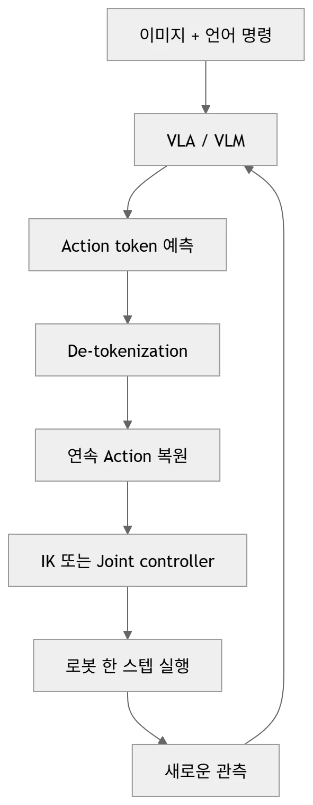

<table>
<tr>
<td width="50%" valign="top">

> 연속된 Action token을 얻는다고, 이를 바로 모터 움직음으로 적용하는 것은 아니다. 이는 한 계층을 더 지나야한다.
>
> ## Control Stack
>
> VLA가 내놓는 Action은 대개 둘 중 하나이다.
>
> - Joint Space Action
>
>   - 예: 각 관절의 목표 각도, 각속도, 또는 변화량
> - End-Effector Space Action
>
>   - 예: 손끝의 위치 변화량, 자세 변화량, gripper 상태
>
> 어느 관점의 space에 따라 로봇을 제어하는 방식이 달라진다. action tokenization 이후에 VLA는 action token을 이산 수로 입력받고, 이 수가 얼마를 움직이라고 지시하는 것인지 다시 역 토큰화를 시켜야 한다.
>
> 이를 de-tokenization 라고 한다.
>
> SmolVLA는 Joint space로, de-tokenization 이후에 각 관절에 적용할 값들을 찾는다. Joint를 기준으로 action하며, 이전 joint 값에서 값을 더해가며, 이상 Joint 값까지 이동시키면 된다.

이러한 방식으로 왼쪽 그림과 같이 VLA는 Loop를 돌며 동작한다.

1. Action token 예측

   - (Tokenization을 사용하는 VLA 경우) Input에 따라 행동 ation을 bin 단위로 예측
2. de-tokenization

   - 모델이 예측한 Action Token을 해당하는 Bin 번호로 해석
3. 연속 Aciton 복원

   - 해당 Bin의 정보를 바탕으로 연속적인 실수 형태의 Action 값을 복원
4. IK 또는 Joint controller

   - EE를 기준으로 정하거나, 관절 목표를 정하고 움직임
5. 로봇 한 스템 실행

   - 한 Chunk의 미럐 예측 한 step을 실행한다.

</td>
<td width="50%" valign="top">

</td>
</tr>
</table>
