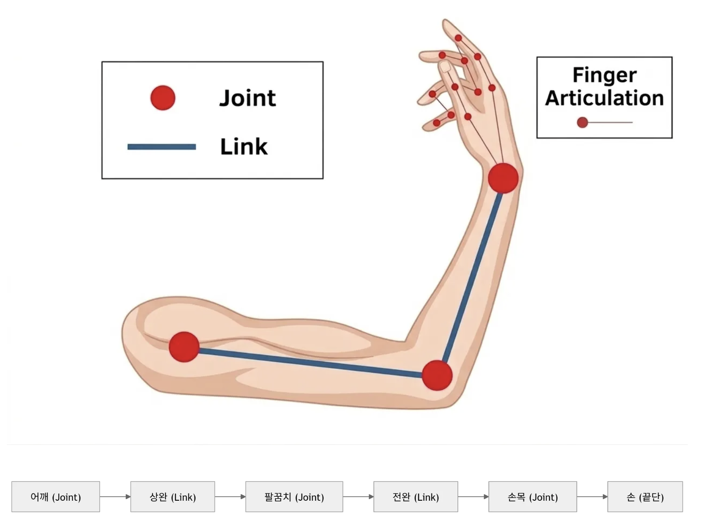
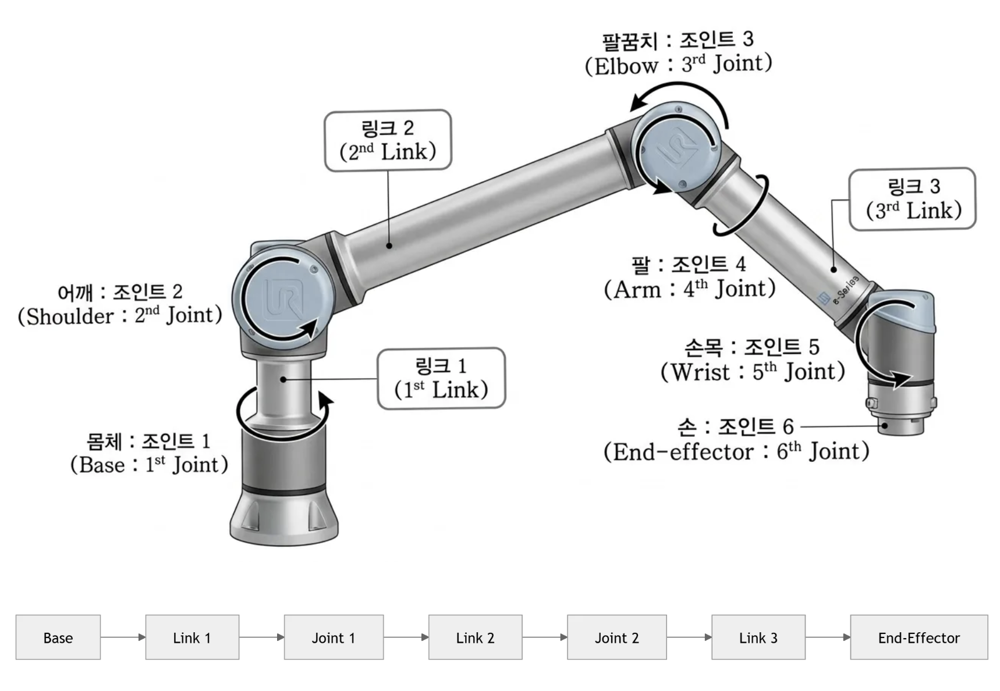
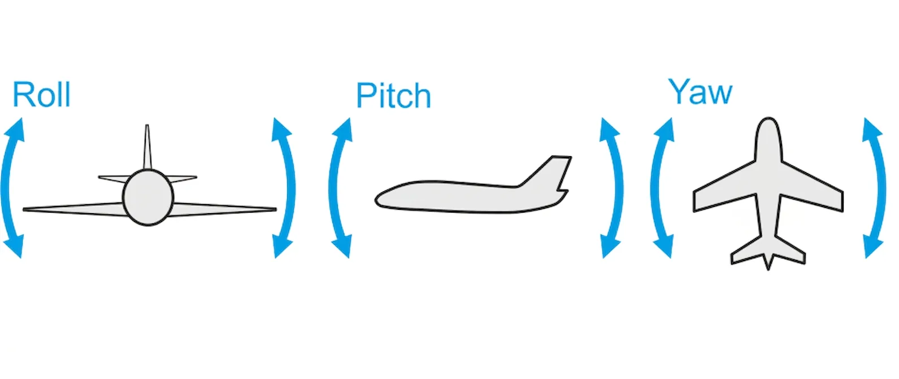
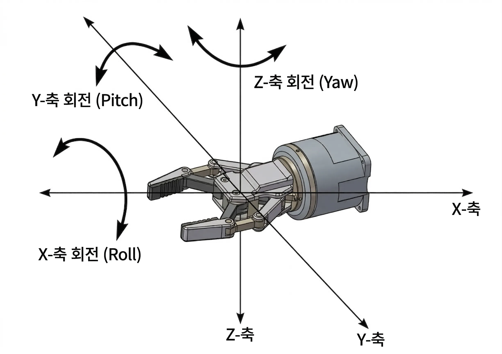
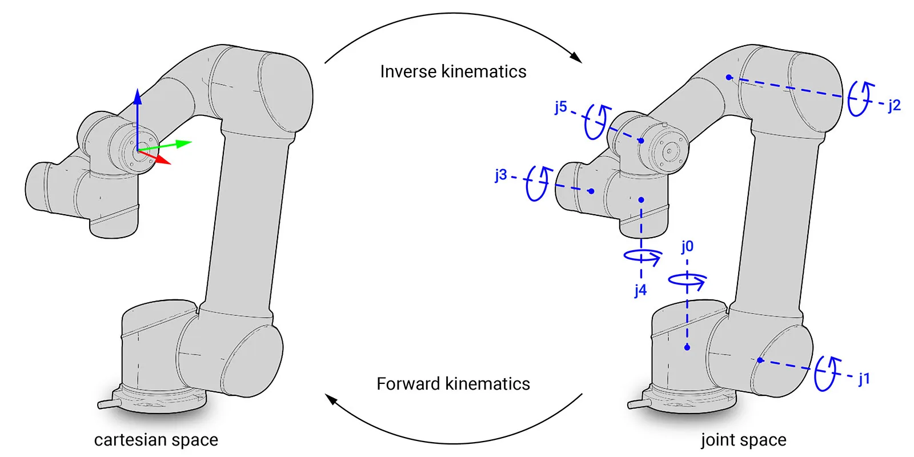

<sub>사진 출처 : 위키 독스</sub>

VLA는 action을 예측한다. 어떤 Language에 따라, 어떤 Vision에 따라 다음 step을 뽑고, action을 구상한다.

실제로 어떤 물체를 잡기 위해서 어디로 움직이고, 팔을 기울여 손을 쥔다.. 와 같은 세밀한 조작이 필요하다.

---

로봇을 이루는 각각의 하드웨어 구조물을 link라 한다. link는 사람으로 따졌을때 어깨부터 팔꿈치가 하나의 link이고, 팔꿈치부터 손목까지가 하나의 link일 것이다.

여기서 Link와 Link를 잇는 것을 Joint라 한다. Joint는 어깨, 팔꿈치, 손목과 같은 관절일 것이다. Link와 Link를 이으며 부드러운 움직임을 만들어내는 주체라 할 수 있다.



이러한 구조라고 할 수 있다. 이 구조는 로봇에도 똑같이 적용된다.



이렇게 Link와 Joint가 번갈아 연결되며 Joint의 변화로 움직임을 만들어내는 구조를 Kinematic-Chain(기구학적 체인)이라고 한다.

DoF (Degree of freedom)은 자유도로, 시스템이 얼마나 자유롭게 동작할 수 있는 방향을 가지고 있나를 의미한다. Joint가 6인 로봇은 6DoF 시스템인 것이다.

DoF가 증가할수록 표현 범위가 더욱 늘어나고, 복잡한 시스템으로 구성될 것이다.

---

Action은 결국 Joint와 DoF 위에서 결정된다. 로봇이 움직인다는 것은 결국 이 값이 바뀌는 것을 의마한다.

#### End-effector

- 로봇이 실제 환경과 상호작용하는 끝부분이며, 그리퍼, 흡착 등이 이에 해당하다.
- 이는 위치(position)와 자세(orientation)로 이뤄진다.
  - 위치 : 손끝이 어디에 있는가?
    - X/Y/X
  - 자세 : 손끝이 어떤 방향으로 놓아져 있는가?
    - Roll/Pitch/Yaw

  

  

이 6가지 정보로 End-effector를 나타낼 수 있기 때문에, 다음과 같이 표현할 수 있다.

```py
[x, y, z, roll, pitch, yaw]
```

Joint로 원하는 End-effector를 얻기 위해서, forward kinematic로, 원하는 End-effector의 위치와 자세를 찾는 것을 inverse kinematics로 다룹니다.

### FK (Forward Kinematics)

Joint로 값을 인력받아 End-effector의 위치와 자세를 계산하는 것이다. 입력이 관절값 (joint), 출력이 손끝 자세 (end-effector) 이다.

### IK (Inverse Kinematics)

먼저 손끝 위치/자세를 정하고, 거기에 맞는 Joint를 찾아가는 과정

로봇의 작업은 End-Effector를 기준으로 동작하지만, 각 관정을 Joint 값으로 동작하기 때문에 두 표현을 연결해주는 매체가 필요하다. IK는 FK와 달리 해가 없을 수도, 무수히 많을 수도 있는 방식이다.


