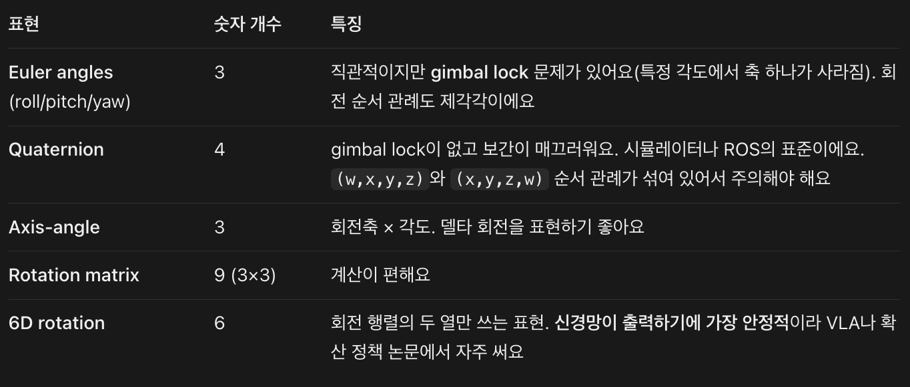

VLA를 해보려 한다. 이게 대세고, 이게 관심사이기 때문에,, 그래서 일단 AI한테 로드맵도 받고 시작했다.

---

먼저 Rust 기반으로 만들어진 Python 프로젝트 관리 패키지 매니저를 까는 게 시작이다.

- 환경 관리
- 대규모 소스 다운

등에서 장점이 있다고 한다.

```c
brew install uv
uv init
uv sync
source .venv/bin/activate
// 시작 
```

이제 Lerobot 플랫폼을 받고, 파이썬 환경을 세팅할 것이다.

```py
uv python install 3.14 # LTS version
uv python pin 3.14
source .venv/bin/activate
uv add lerobot
```

<details>
<summary>Lerobot</summary>

HuggingFace OpenSource ML platform

실제 로봇의 시뮬레이션 환경에서 모방학습과 강화학습을 직관적으로 구현할 수 있게 만든 Pytorch기반 로보틱스 프레임워크이다.

- Imitation Learning (모방 학습)

  - 강확학습은 학습 과정에서 시행착오를 거치며, 좋은 행동을 학습한다. 여기서 모방 학습은 개발자가 먼저 좋은 행동을 제시하고, 로봇은 이를 보고 학습하는 것이다.

  제대로 학습을 시작해보자.

  ---

  모방 학습은 문자대로, 사용자가 제공한 데이터를 보고 모방하여 학습하는 것이다. 이는 사실상 지도 학습으로 분류할 수도 있다.

  모방 학습의 가장 기초적인 방식은 BC (Behavior Cloning)이다. 말 그대로 행동을 복제하는 것이다.

  - BC 장점 : 많지 않은 데이터로 학습해도 꽤 좋은 효율을 보여준다.
  - BC 단점 : 학습하지 않은, 처음 보는 행동은 제대로 하지 못한다. 작은 실수를 점점 학습하며, 점점 처음 보는 형태로 학습이 될 수 있다. 이를 distribution shift라고 한다.

  LeRobot이 IL을 많이 지원하기 때문에 사용이 편하고, 기존에 존재하는 데이터로 학습시킬 수 있다.

- Reinforcement Learning (강화 학습)

  - RL은 강화학습으로 보통 다음 흐름을 반복하며 학습을 진행한다.

  ```py
  상태 관찰 → 행동 → 환경이 변함 → 보상 받음 → 정책 업데이트 → 반복
  ```

  RL에서는 state (상황)을 인지하고, policy (정책)에 따라 action (행동)하며, 이 행동에는 reward (보상)이 주워진다. 해당 과정에서 바로 앞의 큰 보상많을 계산하는 것이 아닌, 앞으로 받을 보상의 총합을 가장 크게 하는 방향으로 action하며 학습한다.

  초기 Agent (학습하는 AI)는 Random Action에 불과하지만, 학습을 진행하며 보상이 높은 (올바른) 행동을 학습하고, 점점 정교해진다.

  학습에는 여러 알고리즘이 사용되지만, 대표적인 2가지만 소개할 예정이다.

  - Proximal Policy Optimization
    - PPO 알고리즘은 점수를 보는 것이 아닌, 특정 상황에서 어떤 행동이 Best인지, 이 자체를 학습한다
    - 즉, 신경망이 “이 state에  이 action이 80%로 정답이지.” 라고 판단하는 것이다.
    - On-policy 방식이다.

      - Agent가 가지는 최신 정책으로만 움직여서 얻은 데이터로만 학습하는 것이다. 생각하는대로 움직이기 때문에 정확도는 높지만, 과거의 Agent와 정책이 다르기 때문에 한번 사용한 데이터는 버려야한다.

        ⇒ 데이터 효율성이 낮다.34
  - Soft-Act-Critic
    - SAC 알고리즘은 보상만 최대호 하는 것이 아닌, 엔트로피도 최대화한다. 엔트로피는 다양한 행동을 하는 것을 의미하므로, 해당 알고리즘으로 학슴한 Agent는 한 행동에 매몰되지 않고, 다양한 Action을 할 것이다.
    - 가장 뛰어난 RL 알고리즘으로 평가받지만, 이는 하이퍼파라미터 (사용자 설정 변수)를 설정하는 것이 꽤 까다롭다.
    - Act - Critic이름대로 배우와 비평가이다. Actor는 현재 어떤 행동을 할지 판단하고, Critic은 이 행동이 얼마나 괜찮은지 평가한다.
    - Off-policy 방식이다.

      - 과거의 Agent가 생성한 데이터를 가지고, 이를 통해 정책을 학습하는 것이다. 과거 데이터를 재사용하므로 데이터 효율성이 높다.

        ⇒ 과거의 데이터는 과거의 것이므로, 학습 안정성이 떨어진다.

</details>

이제 Lerobot의 경량 Foundation model인 smol을 추가할 것이다.

```py
uv add "lerobot[smolvla]"
uv run python [name.py]
```

이걸 가지고 시뮬레이션에서 큐브를 집는 스크립트를 실행했다. 로보틱스 개념을 하나씩 학습해보자.

<details>
<summary>Joint</summary>

로봇은 뼈대 (Link)와 관절 (Joint)가 연결되는 구조로 이뤄진다. 아래와 같은 흐름으로 이어지며, 이를 kinematic chain 이라고 한다.

```py
[Base] ─J1─ 링크 ─J2─ 링크 ─J3─ 링크 ─J4─ 링크 ─J5─ [그리퍼 J6]
```

여기서 움직이는 Joint는 2가지 방식으로 나뉜다.

- Revolute (회전 관절): 각도로 움직인다. 라디안 또는 도)
- Prismatic (직선 관절): 길이로 움직여인다.

### DoF (Degrees of Freedom)

- 자유롭게 움직일 수 있는 관절을 의미한다. 3DoF라면, 3개의 자유 관절을 가졌다는 의미이다.
- 3D 공간에서 물체를 완전히 움직이려면 적어도 6DoF는 완성시켜야 한다.

  - 위치 : x, y, z
  - 회전 : oll, pitch, yaw
- 5DoF 로봇은 표현에 한게가 있다. 반대로 7DoF는 최소 DoF 개수를 넘으며, 이는 redundant(여유 자유도)라고 한다.

### End Effector

로봇의 끝에 붙게되는 장치를 의미한다. 여기에는 용접기, 토치, 그리퍼 등이 해당한다. 여기서는 EE pose가 가장 중요하다.

- EE pose : 손끝의 방향과 위치
- TCP (Tool Center Point) : EE pose의 정확한 기준점을 의미한다. 보통의 그리퍼는 두 집게 사이를 중앙으로 잡아 움직인다.
- pose : 위치 + 방향으로, 이를 표시하는 공식 역시 다양하다.

  - 실제로 정말 많은 종류가 존재하기 때문에 나중에 사용하는 pose 표현 방식만 리뷰하도록 하겠다.

  

<details>
<summary>Code</summary>

실제 이해를 돕기 위해서 코드와 함께 보도록 하겠다. 먼저 하드웨어 모터를 실제 DoF로 연결하는 것이다.

```py
"shoulder_pan":  Motor(1, "sts3215", norm_mode_body),
"shoulder_lift": Motor(2, "sts3215", norm_mode_body),
"elbow_flex":    Motor(3, "sts3215", norm_mode_body),
"wrist_flex":    Motor(4, "sts3215", norm_mode_body),
"wrist_roll":    Motor(5, "sts3215", norm_mode_body),
"gripper":       Motor(6, "sts3215", MotorNormMode.RANGE_0_100),
```

다음과 같은 식으로 연결한다. 여기서는 6DoF로 kinematic chain을 만든다.

Smolvlal는 각종 매서드로 Present\_action (현재 모터 값)을 읽고, 목표 각도를 선정한다.

```py
action(6, ...)
```

위 방식으로 6개의 DoF를 제어하는 것이다. 학습을 할때 관절 순서, 단위, 좌표계 관례 등의 시퀀스를 지켜야 AI가 만든 state에 맞게 행동한다.

<details>
<summary>추론</summary>

```py
policy = SmolVLAPolicy.from_pretrained(MODEL_ID)
policy = policy.to(device).eval()
```

- 모델을 로드한다.
- 다운받은 정책을 디바이스에 클론하고, Dropout (학습) → eval (추론) 모드로 전환한다.

```py
preprocessor, postprocessor = make_pre_post_processors(
    policy.config,
    MODEL_ID,
    preprocessor_overrides={"device_processor": {"device": str(device)}},
)
```

정책을 가지고 파이프라인을 구성한다. ID를 다시 넘겨서 같은 학습 모델을 사용하도록 명시한다.

</details>

<details>
<summary>Batch & Chunk</summary>

- Batch : 서로 관계 없는 샘플 몇 개를 한번에 처리하는가?
  - 한번에 여러 상황을 처리하는 정도를 의미하는 값이다.
- Chunk : 한 번의 예측으로 미래를 얼마나 고려하는가?
  - 미세한 시간 마다 새로 다음 스텝을 정하는 것이 아니라, n초 동안 행동할 스텝을 한번에 추론해내는 것이다.
  - 매 스텝을 계속 추론하기 너무 무겁기 때문에

학습 상황에서 Batch의 값을 클 것이고, 추론에서는 한 상황을 받으므로 1이 보편적인 값일 것이다.

Chunk는 상황과 위치마다 step 크기가 제각각이다. 평균적으로 16 \~ 50 step 값을 사용한다.

</details>

</details>

</details>
