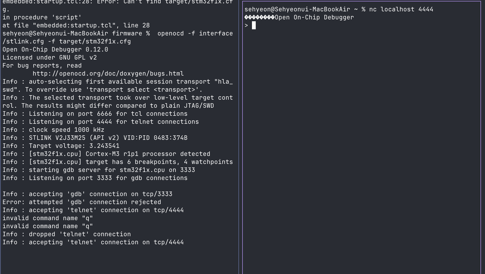
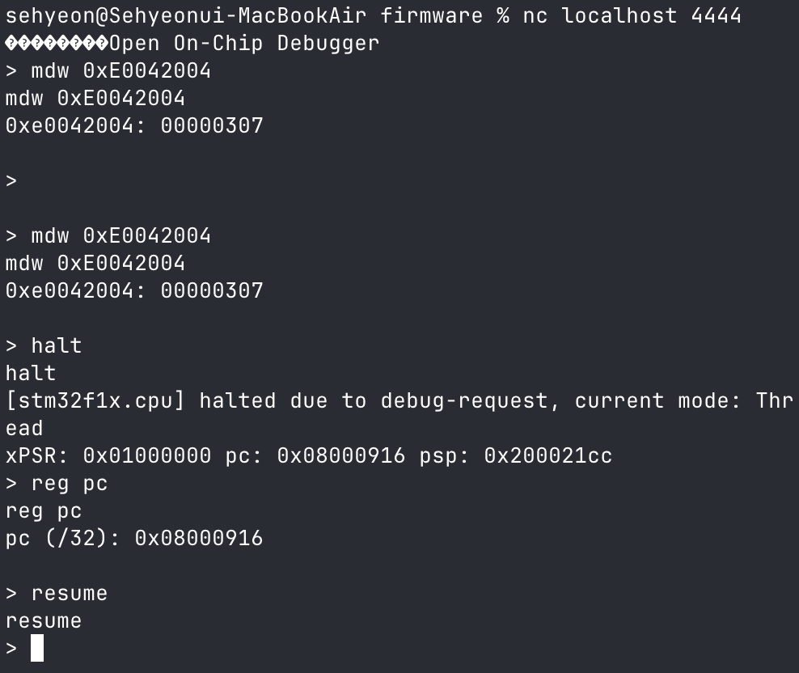
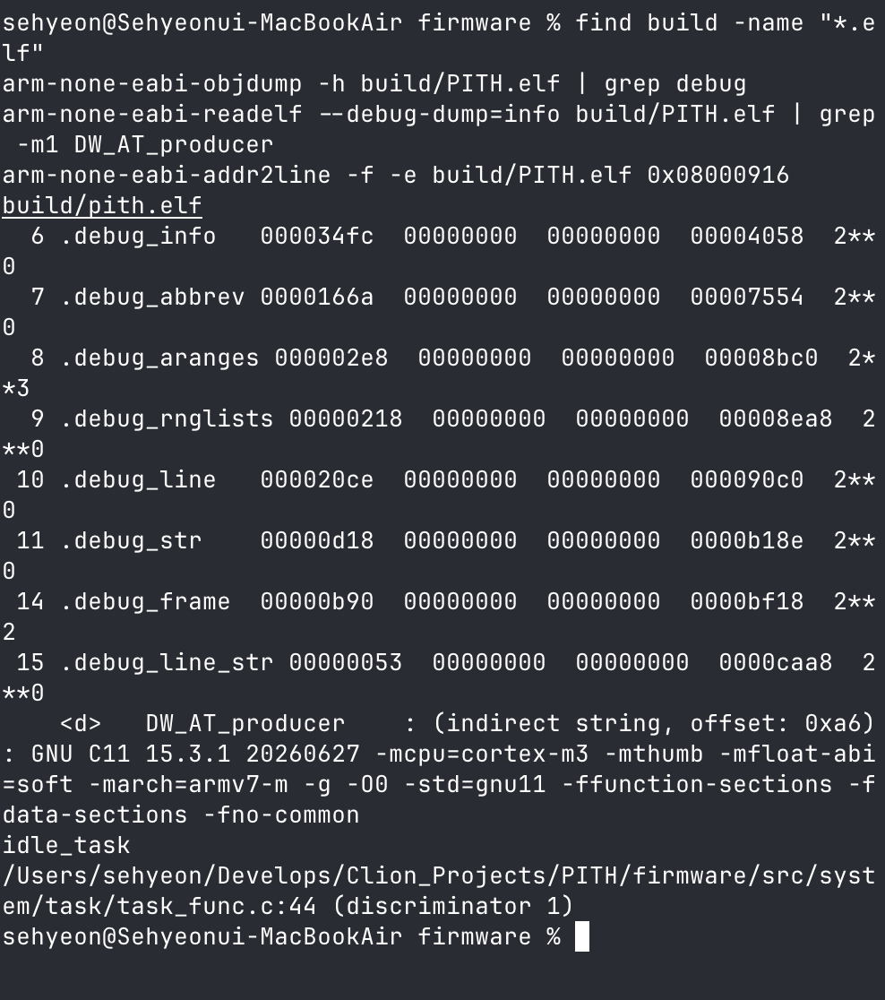
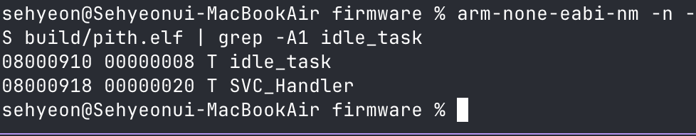
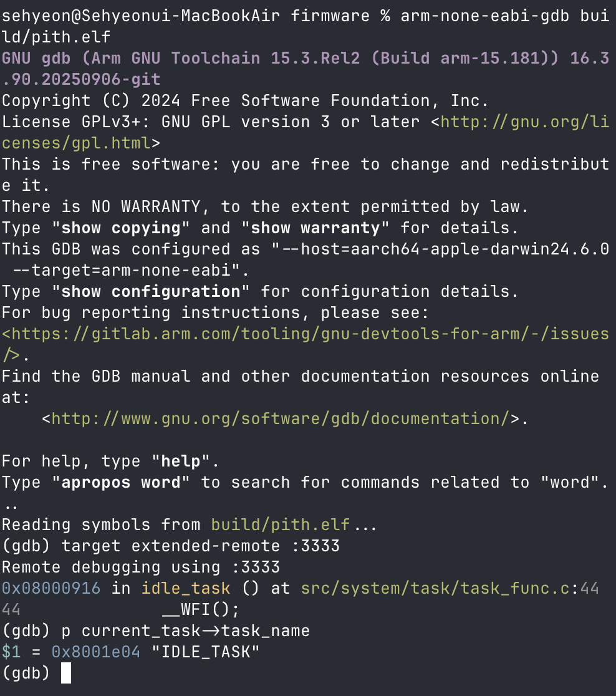
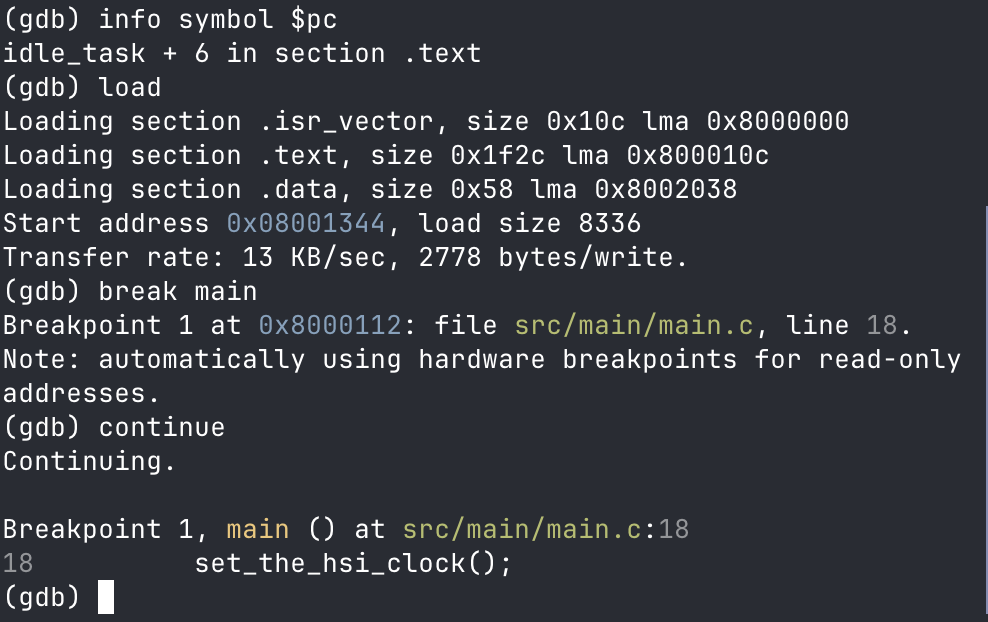
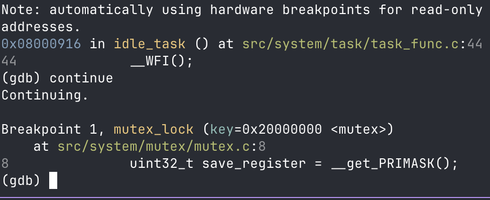
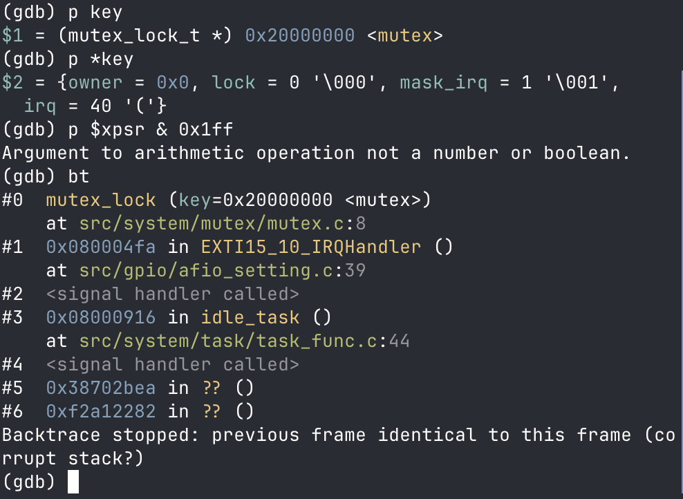
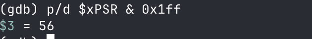
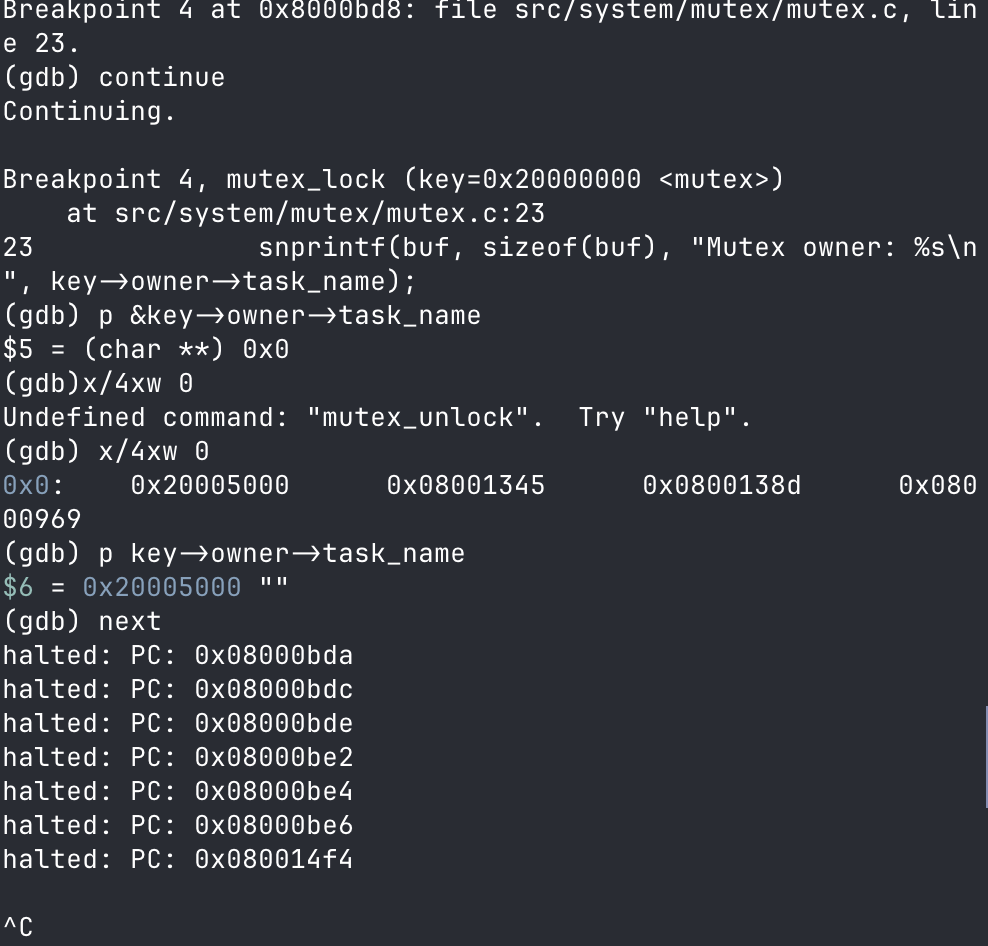

- 역참조 복슴
    
    역참조는 가지고 있는 주소의 객체에 접근하여 값을 조회 또는 변경하는 것을 의미한다. 
    
    ```c
    int a = 10;
    int *p = &a
    
    printf("%d", *p);
    ```
    
    이는 역참조이다. p의 주소는 a이고, 객체 a의 값 10을 조회하기 때문이다. 
    
    또한 구조체 포인터 접근은 모두 역참조이다. 
    
    ```c
    typedef struct { 
    	int key; 
    } ex;
    
    int main(void) {
        ex obj = {
    		  1
    		};
    		
        ex *item = &obj;
        printf("%d", item->key);
    }
    ```
    
    다음과 같이 `->` 를 사용하는 것은 `(*item).key` 와 같은 것으로, item을 참조 → obj를 참조 → key를 참조하는 것으로 역참조이다.
    
- OpenOCD & GDB
    - Open on-chip debugger : MCU 내부를 디버깅하는 오픈소스이다.
        - GDB 명령을 STM32가 이해 가능하도록 변환하여 ST-Link로 전송하는 디버거 앱이다.
    - GNU debugger : GNU 프로젝트 디버거로, 레지스터 및 메모리 확인을 하며 OCD와 같이 사용할 수 있다.
        - 특정 값을 확인하고, Breakpoint를 제어하는 디버거 앱이다.
    
    이전에 배웠던 SWD/JTAG와 개념이 혼동된다. 이것들은 하드웨어 디버거 인터페이스로, Flash를 가능하게 하며, BreakPoint를 걸며 디버깅을할 수 있게 해준다고 했는데, 이 개념들은 계층적 차이가 있다.
    
    ```c
    [PC]
      GDB            소스 줄 / 변수 이름 / 타입을 앎
       │  GDB RSP (TCP 3333)
      OpenOCD        칩 종류, 플래시 쓰는 법, 디버그 레지스터 위치를 앎
       │  USB
    [Nucleo 위쪽]
      ST-LINK        USB 명령을 SWD/JTAG 신호로 바꿈
       │  SWD (2선) 또는 JTAG (4~5선)
    [STM32 칩 안]
      DAP            디버그 접근 포트. 신호를 받아 칩 내부 버스에 읽기/쓰기를 걸어줌
       │  내부 버스
       ├─ DHCSR      CPU 멈춤 / 재개 / 한 스텝
       ├─ FPB        브레이크포인트 비교기
       ├─ DWT        워치포인트 비교기
       └─ SRAM, Flash, GPIO 같은 주변장치
    ```
    
    이를 나열하고, 확인하면 다음과 같다. 
    
    ```c
    PC (값 확인 명령) -> GDB -> OpenOCD 변환 -> ST-link -> JTAG or SWD
    ```
    
    여기서 JTAG/SWD는 디버깅을 직접 하는 주체가 아닌, OpenOCD로 변환된 GDB가 통신할 수 있도록 규격대로 개발된 회로이다. 
    
    그러므로 JTAG/SWD는 하드웨어 인터페이스이다. (하드웨어 규격)
    

---

보드에서 IDEL task는 RTOS 환경에서 진행할 작업이 없을 때 전력 소모를 아끼기 위해서 보드를 `__WFI` 로 재워둔다. 하지만 이 경우에 CPU 클럭과 HCLK 버스 클럭이 꺼지며, SWD 버스를 타고 들어오는 신호가 막히며, 디버깅을 할 수 없는 상태가 된다. 

그렇기 때문에 보드는 sleep 상태로 옮기고, 버스 클럭은 살리는 Data Bus Group의 매서드를 사용한다.

```c
DBG_sleep()
```

---

PITH 프로젝트는 make 시  build/ 에 elf가 생긴다. GDB를 사용할때 실제 보드에서 어느 위치에 주소가 뭘 의미하느지 아무도 알 수 없다. 그렇기 때문에 이를 비교하며 볼 수 있도록 컵파일 후 파일인 elf를 제공하여, 실제 보드 내부에서 어떤 기계어가 뭘 의미하는지 안내한다. 

아래 코드를 사용하여, 디버깅 정보를 띄우고 보드를 서버처럼 사용한다.

```c
openocd -f interface/stlink.cfg -f target/stm32f1x.cfg

Info : auto-selecting first available session transport "hla_swd". To override use 'transport select <transport>'.
Info : The selected transport took over low-level target control. The results might differ compared to plain JTAG/SWD
Info : Listening on port 6666 for tcl connections
Info : Listening on port 4444 for telnet connections
Info : clock speed 1000 kHz
Info : STLINK V2J33M25 (API v2) VID:PID 0483:374B
Info : Target voltage: 3.243541
Info : [stm32f1x.cpu] Cortex-M3 r1p1 processor detected
Info : [stm32f1x.cpu] target has 6 breakpoints, 4 watchpoints
Info : starting gdb server for stm32f1x.cpu on 3333
Info : Listening on port 3333 for gdb connections
```

- 6666/4444 포트에서 telnet 접속 가능
- 1MHz 속도로 동작
- Info : STLINK V2J33M25 (API v2) VID:PID 0483:374B : ST Link probe 확인
- target has 6 breakpoints, 4 watchpoints
    - FPB 6개
        - FPB(Flash Patch and Breakpoint)는 실행할 명령어의 주소를 가진다.
        - FPB가 가지는 주소에 접근 시 Break
        - 최대 6개의 break point를 설정할 수 있다.
    - DWT 4개
        - DWT(Data Watchpoint and Trace)는 읽고 쓰는 데이터의 주소를 가진다.
        - DWT가 가지는 주소에 값을 조회하거나 변경 시 Break
        - 최대 4개의 beeak point를 만들 수 있다.
- Listening on port 3333 for gdb connections : 4444포트로 gdb telnet 접속 대기
    
    ⇒ `nc localhost 4444`
    

---



포트로 접근하고, 서버로 띄워둔 세션이 이를 받아들인 것을 볼 수 있다. 

---

```c
mdw 0xE0042004 
halt
reg pc
resume
```

1. CPU control regi 접근
    - `00000307` 마지막 자리가 홀수이므로 DBG_Sleep이 잘 켜져서 보드는 잠들고, 버스는 깨어있음을 확인할 수 있다.
2. cpu 멈추기
    
    ```c
    [stm32f1x.cpu] halted due to debug-request, current mode: Thread
    xPSR: 0x01000000 pc: 0x08000916 psp: 0x200021cc
    ```
    
    - mode : Thread ⇒ ISR이 아닌 일반 모드에서 멈췄다.
    - 다음 명령은 FLASH에서 0x08000916에 위치한 것을 가져올 것이다.
    - Task마다 PSP에 적재하므로, task 코드 중 멈춘 것을 알 수 있다.
3. 멈춘 순간의 PC 읽기
    - `pc: 0x08000916`
4. 재개
    
    
    

---

이후 elf 파일 자체에서 `0x08000916` 주소가 어떤 것을 의미하는지, 각종 디버깅 정보와 함께 확인할 것이다. 
이는 gdb 서버에 접속한 telnet을 끊고 진행한다.

```c
find build -name "*.elf"
arm-none-eabi-objdump -h build/PITH.elf | grep debug
arm-none-eabi-readelf --debug-dump=info build/PITH.elf | grep -m1 DW_AT_producer
arm-none-eabi-addr2line -f -e build/PITH.elf 0x08000916
```

- img
    
    
    

위 사진의 addr2line의 값과 아래 사진으로 자세히 보면 현재 `halt` 시점에서의 task는 idle task였다. (가잠 많은 시간을 보낸 task)

또한 PC의 값은 실제로 task_func.c의 44줄을 실행할 준비를 하고 있었다.



```c
void idle_task (void) {
    for (;;) {
        __WFI();
    }
}
```

이는 IDLE task가 실행하는 유일한 기능으로서 `__WFI` 가 PC에 들어가 있었다. 

---



```c
arm-none-eabi-gdb build/pith.elf
target extended-remote :3333
p current_task->task_name
```

실제로 직접 명령어를 입력하여 보면, idle task의 __WFI 앞에서 BreakPoint를 걸고 디버깅을 하는 것을 확인할 수 있다. 

---

```c
info symbol $pc
load
break main
continue
```

먼저 링커 심볼 테이블에서 PC가 어떤 심볼을 가지는지 확인한다. 이후 칩에 들어가야 하는 부분만 load한다. 여기서 main에 도달하면 break를 건다.



결과에서 pc의 심볼 링크는 .text이다. 이는 idle_task에서 + 6 바이트 뒤의 주소이다. 
현재 주소인 Idle task 코드는 코드 저장 영역인 .txt에 저장되었다.

⇒ PC (__WFI)의 심볼은 .txt이다. 이는 링커가 실제 메모리 영역에서 text에 배치할 것을 의미한다. 즉 PC 주소의 명령어는 .txt 링커 심볼을 가지고 이에 따라 text 영역에 저장될 것이다.

```c
(gdb) disassemble idle_task
Dump of assembler code for function idle_task:
   0x08000910 <+0>:
Cannot access memory at address 0x8000910
// 현재 IDLE task의 주소
```

---

이제 우리의 본 목적인 ISR 상태에서 mutex_lock을 확인할 것이다. 그렇게 하기 위해서는 break point를 mute_lock으로 옮겨야한다. 6개 중 FPB 2개의 point를 사용한다. 

버튼 ISR에서 mutex를 사용하므로 break point를 만들고, user button을 사용하여 ISR에 진입한다. 



break point를 걸고, ISR 진입 시점에서 멈춘 상태이다. 여기서 p (print) 명령어를 사용하여 각종 정보를 본다.



현재 mutex_lock 자체는 아무것도 잡지 않기 때문에 RAM의 가장 앞 부분인 `0x20000000` 에 위치한다. (호출된 함수이므로 stack에 위치) 

중간에 에러가 난 부분을 다시 보면, 현재 CPU가 56번째 인터럽트를 실행중인 것을 알 수 있다. 



마지막 bt는 backtrace로, 현재 주소까지 온 흐름을 보여준다. 여기서는 

```c
#0  mutex_lock
#1  EXTI15_10_IRQHandler
#2  <signal handler called>
#3  idle_task
```

이러한 흐름으로 오게 되었다. #4 부터는 쓰레기 값이 출력된 모습이다. 우리는 mutex_lock을 어느 task가 잡는지 보아야 하므로 mutex.owner에 DWT를 하나 붙인다.

```c
 watch mutex.owner
 continue (감지 전까지 반복)
 
 p/d $xPSR & 0x1ff
 bt 
 
#0  0x08000c2e in mutex_unlock (key=0x20000000 <mutex>)
    at src/system/mutex/mutex.c:37
#1  0x08000520 in EXTI15_10_IRQHandler ()
    at src/gpio/afio_setting.c:46
#2  <signal handler called>
#3  0x08000916 in idle_task ()
    at src/system/task/task_func.c:44
```

bt를 통해 back tracer결과 중 #2번에서 하드웨어 인터럽트 로그를 확인할 수 있다. 즉 버튼을 누르며 발생한 Hardware interrupt가 ISR로 처리되며 해당 lock을 얻고, break point에 멈춘 것이다. 

---

마지막으로 owner가 NULL인 버그를 재현하여 디버깅 로그를 확인할 것이다. 

이를 위해서 설정했던 DWT를 지우고, 새 break를 걸고, 변수에 의도적 값을 대입한다. 

```c
delete (y)
break mutex_lock
continue 

set var key->lock = 1
p *key

...
```



owner 값에 의도적으로 NULL을 대입했다. 23장의 Unmapped문제와 비슷한 유형으로 매핑되지 않은 NULL값은 Hardfault를 일으켰고, halted가 중간에 멈췄고, 의도적으로 중지된 모습이다. 이로써 버그 재현까지 마무리한다.

디버깅이 종료되고, 모든 break point를 delete하고, monitor reset run으로 돌려놓고, quit하며 디버깅을 종료한다. 

OpenOCD +GDB 사용 끝.
